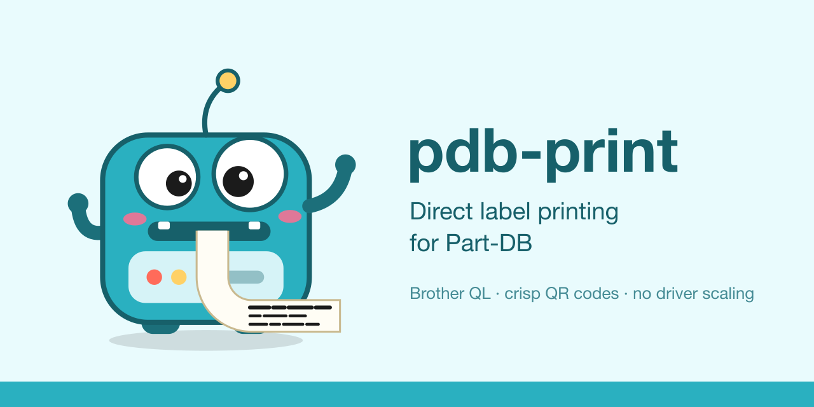

<p align="center"></p>

# partdb-print-agent

Direct label printing for [Part-DB](https://github.com/Part-DB/Part-DB-server).

A small cross-platform agent (`pdb-print`) that takes the label PDFs Part-DB already generates,
rasterises them at the printer's native resolution and sends them straight to your label printer –
crisp QR codes, exact sizes, automatic cutting, no fiddling with OS print dialogs.

**Status:** early development. First target: Brother QL printers over the network.

- Works with Part-DB as it is today (read-only API token).
- Planned: Zebra/ZPL, TSPL, ESC/POS, DYMO, Niimbot, Phomemo, normal printers and A4 label sheets;
  instant printing from any device through NAT via an optional Part-DB extension.

## Usage (early)

```sh
go build -o bin/pdb-print ./cmd/pdb-print
cp .env.example .env          # fill in PDB_PRINT_TOKEN (Read-Only API token), then:
set -a; . ./.env; set +a      # loads PDB_PRINT_URL / PDB_PRINT_TOKEN / PDB_PRINT_CONFIG

bin/pdb-print printers status ql810                           # model, errors, loaded roll
bin/pdb-print printers test ql810                             # test label sized for the media
bin/pdb-print print --profile 2 --ids 32 --printer ql810      # fetch from Part-DB and print
bin/pdb-print print --profile 2 --ids 32,112-125 --type part --printer ql810
bin/pdb-print print label.pdf --printer ql810                 # local PDF
bin/pdb-print render label.pdf --printer ql810 -o /tmp        # PNG preview at head dots
bin/pdb-print media                                           # known Brother QL media
```
### Web UI and bookmarklet

```sh
bin/pdb-print serve            # http://127.0.0.1:8631
```
In the UI: connect Part-DB (the token goes to the OS keychain), add printers, map label profiles to
printers, then drag the generated bookmarklet to your bookmarks bar. On a part or storage-location page
in Part-DB, clicking it opens a small window that prints the label. The bookmarklet signs each request
with a per-install key, so other websites can't print through the agent without a click.

Add `--dry-run job.bin` to any print command to write the printer byte stream instead.
Printers (and optionally Part-DB instances with a `token:`) live in a YAML config:
see `config.example.yaml`; copy it to `config.local.yaml` (gitignored) to customise.

Tests: `go test ./...` (never prints; a fake printer runs on localhost).
`go test ./... -update` rewrites golden files – inspect the diff first.
Icons: edit the SVGs in `assets/icon/` (or `docs/logo.svg`) and run `scripts/gen-icons.sh`
(needs `brew install librsvg imagemagick`, plus `iconutil` from macOS); the output is committed.

Status-only hardware check: `PDB_PRINT_QL_ADDR=host:9100 go test -tags hardware ./internal/driver/brotherql`.

See [`docs/architecture.md`](docs/architecture.md) for the full design.

## License
MIT
