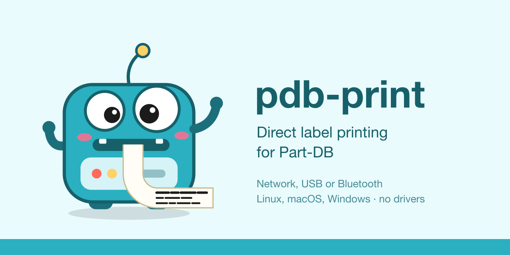
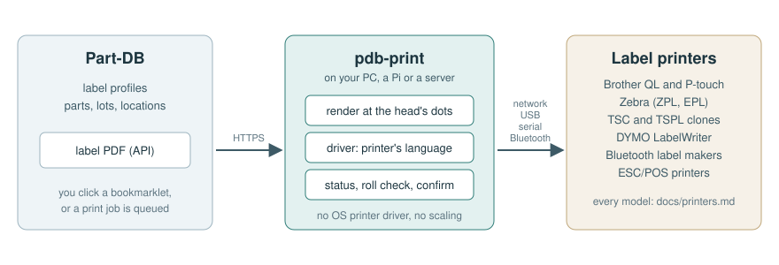
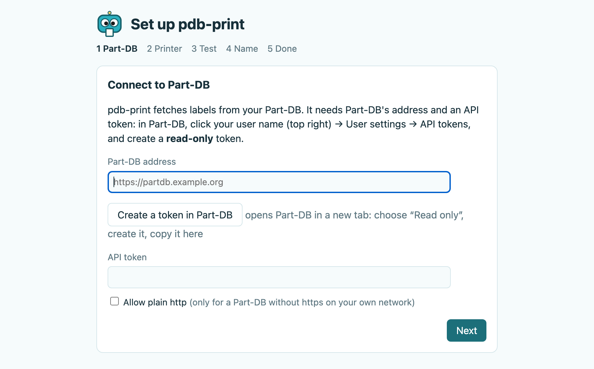
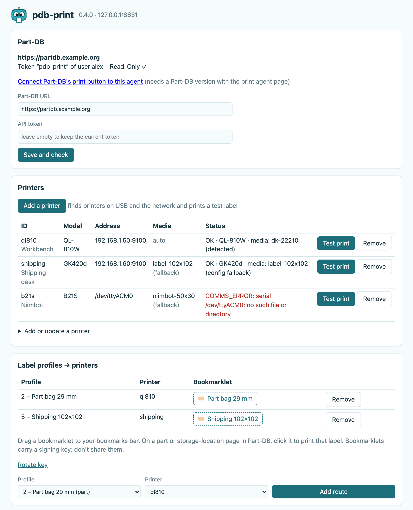

<p align="center"></p>

# pdb-print

Direct label printing for [Part-DB](https://github.com/Part-DB/Part-DB-server).

A small cross-platform agent (`pdb-print`) that takes the label PDFs Part-DB already generates,
rasterises them at the printer's native resolution and sends them straight to your label printer over
the network, USB, serial or Bluetooth – crisp QR codes, exact sizes, no printer drivers or OS print dialogs.
It runs on Linux, macOS and Windows.

## TL;DR

1. **Install** pdb-print on the computer you work at ([Windows installer, Homebrew](#install)) or on a
   Raspberry Pi or server next to the printer ([install script or Docker](#install)).
2. **Set up** in the browser: the [wizard](#set-up) connects Part-DB with a read-only API token, finds your
   printer and prints a test label.
3. **Drag the [bookmarklet](#web-ui-and-bookmarklet)** to your bookmarks bar (until Part-DB gets its own
   Print button).
4. **Print:** on a part or storage location in Part-DB, click the bookmarklet. The label comes out at the
   right size with sharp QR codes, no printer drivers involved.

<p align="center"></p>

## How it works

1. You ask for a label: with the bookmarklet on a Part-DB page, a Print button (with a Part-DB that has
   the proposed print support, see below), a PDF saved to a hot folder, or `pdb-print print`.
2. pdb-print fetches the label PDF from Part-DB's API (a read-only API token is enough) or reads the file.
3. It renders the page at the print head's exact dots, turned to fit the loaded label, without
   anti-aliasing, so QR codes and barcodes stay sharp.
4. A driver speaks the printer's own language (Brother raster, ZPL, ESC/POS …) over the network, USB or
   Bluetooth. Before each job it checks the printer's status and, where the printer reports it, the
   loaded roll; after it, whether the label printed.

pdb-print runs on the computer you work at, on a Raspberry Pi next to the printer, or in Docker. It works
with Part-DB as it is today. A Print button inside Part-DB and print jobs from any device (also a phone)
are proposed upstream in [Part-DB-server#1625](https://github.com/Part-DB/Part-DB-server/issues/1625).

**Status:** everything described here is in the [latest release](https://github.com/francisrath/pdb-print/releases/latest). pdb-print is pre-1.0: the config
format may still change between releases (the release notes say how). Which printers have been tested on
real hardware, and which are implemented from the documentation only, is in [docs/printers.md](docs/printers.md).

## Supported printers

| Family | Connections | Models | Tested |
|---|---|---|---|
| Brother QL | Network, USB | QL-560 … QL-820NWB, wide QL-1050/1060N/1100/1110NWB/1115NWB | ✅ QL-810W |
| Brother P-touch | USB, Network, Bluetooth Classic | PT-9500PC, PT-E550W, PT-P750W, PT-P710BT, PT-P900 series … | ✅ PT-9500PC |
| Zebra (ZPL) | Network, USB, Bluetooth Classic, Serial | GK, GX, GC, ZD, ZP, ZT and ZQ series, LP2844-Z | ✅ GK420d (community) |
| Zebra (EPL2) | USB, Network, Serial | LP/TLP 2824, 2844, 3842, 2722/2742 … | 🟡 not yet |
| TSC and TSPL clones | USB, Network, Bluetooth Classic | TSC, Xprinter, Munbyn, iDPRT, HPRT | 🟡 not yet |
| DYMO LabelWriter | USB, Serial (330) | 330, 400, 450 series, 4XL | 🟡 not yet |
| Bluetooth "cat printers" | Bluetooth LE | GB01–03, GT01, YT01, MX05–MX10 | ✅ MX10 |
| Niimbot, Phomemo | Bluetooth LE, USB serial (B21S) | Niimbot B1, B21, D11, D110 …; Phomemo M02, M110, M200, D30 … | ✅ B21S |
| ESC/POS receipt printers | Bluetooth Classic | REGO RG-MLP80B, generic 58/80 mm | 🟡 not yet |

✅ tested on real hardware, 🟡 implemented from the documentation but not tested yet, ⏳ not supported
yet, ❌ can't be supported. Every model with its status, the printers that aren't supported, and how to
help test one: [docs/printers.md](docs/printers.md).

## Install

**Raspberry Pi OS, Debian, Ubuntu** (a print server, e.g. a Raspberry Pi next to the printer):

> **Before installing:** for up to 30 minutes the setup page is open to the network (see below), protected
> only by a 6-digit code. Check who can reach TCP port 8631 on the print server: anyone who can, and
> sees the code first, can set it up. On a network with devices you don't trust, or a print server
> connected straight to your internet provider, limit port 8631 to trusted machines with a firewall
> first. pdb-print only filters out obviously remote addresses; that is not a firewall.

```sh
curl -fsSL https://github.com/francisrath/pdb-print/releases/latest/download/install.sh | sh
```
Or read it first: download `install.sh` from the release, read it (about 40 lines), then `sh install.sh`.
Every release file comes with a signed build provenance: `gh attestation verify <file> --repo francisrath/pdb-print`
shows it was built by this repository's release workflow from the tagged commit.
The script picks the `.deb` package for your system, checks it against the release's `checksums.txt`,
installs it with `apt-get` (the one step that needs `sudo`) and shows a setup code. The package adds:
- `/usr/bin/pdb-print`;
- a `pdb-print` system user, allowed to use USB printers (group `lp`), Bluetooth (group `bluetooth`) and serial ports (group `dialout`);
- a `pdb-print` systemd service; its config is `/var/lib/pdb-print/config.yaml`.

Its scripts only create that user and an empty config, enable and (re)start the service, and stop
it on removal, through Debian's `deb-systemd-helper`/`deb-systemd-invoke`, so a service you disabled
stays disabled on upgrades (`packaging/deb/`).
On 32-bit Raspberry Pi OS it also installs `poppler-utils`, whose `pdftoppm` renders labels much faster there.
Then go on with [Set up](#set-up).

**macOS / Linux (Homebrew):**
```sh
brew tap francisrath/tap
brew trust francisrath/tap      # Homebrew 7 only loads casks from trusted taps
brew install --cask pdb-print
```
The macOS binaries are signed with a Developer ID and notarised by Apple.

**Windows:** download `pdb-print_…_windows_amd64_setup.exe` from the
[releases page](https://github.com/francisrath/pdb-print/releases) and run it; choose "Install for me
only" (no admin needed) or "for all users" (the Windows service below). Or download the
`windows_amd64` zip, unzip it and double-click `pdb-print.exe`, then answer the question with Enter;
or run `pdb-print install` in a terminal (`--quiet` skips opening the web UI). Silently:
`setup.exe /VERYSILENT` for your user, `setup.exe /VERYSILENT /ALLUSERS` (as administrator) for the
service, `/NOSELFUPDATE` to turn self-update off. It installs for your user only (no admin needed) into
`%LOCALAPPDATA%\Programs\pdb-print`, starts at login without a window and adds the web UI to the
Start menu. Its log is in `%LOCALAPPDATA%\pdb-print\pdb-print.log`. To remove it: Settings → Apps →
pdb-print, or `pdb-print uninstall` (`--purge` also deletes the config in `%AppData%\pdb-print`).
Until releases are signed, SmartScreen warns about the download and the first start: "More info" →
"Run anyway".

**Windows service:** for labels printed while nobody is logged in, or a PC several people share, run
setup.exe "for all users", or `pdb-print install --service` in a terminal opened as administrator. It installs into
`%ProgramFiles%\pdb-print` and runs as the Windows service `pdb-print`, started with Windows. Config
and log are in `%ProgramData%\pdb-print` (`config.yaml`, `pdb-print.log`), readable by administrators
only. It replaces your per-user install and copies its config; a Part-DB token kept in your keychain
doesn't move, so enter it again in the web UI. Only the per-user install of the account you run it as
is replaced: other accounts remove theirs from their own Settings → Apps. A folder in
`%ProgramData%\pdb-print` that an administrator didn't make is moved aside
(`pdb-print.untrusted.<time>`) and a new one created. The service runs as SYSTEM: `~` in
`hot_folder.dir` is the system profile, so give an absolute path, and use a folder other users can't
write to (the service deletes and moves the files in it). What the installer and the service write
there is owned by Administrators; a file you put there yourself relies on Windows' default owner for
objects administrators create ("Administrators group"): with the policy "System objects: Default owner
for objects created by members of the Administrators group" set to "Object creator", the service
refuses its folder. If the service doesn't start, the reason is in its log or in Event Viewer →
Windows Logs → Application (source `pdb-print`); after a failure it restarts after 5 s, then 1 min,
then every 5 min. The web UI asks every browser for a code: in Terminal (Admin) or PowerShell as
administrator, run `& "C:\Program Files\pdb-print\pdb-print.exe" pair` (in Command Prompt without the
`&`) and type the code it shows. A paired browser stays signed in for 30 days; "Sign out all browsers"
in the web UI signs every browser out, and so does every `pdb-print install --service` (an upgrade
too). Pairing keeps other users of the PC from casually changing the settings; it doesn't stop a
determined local user who can run programs (one could, for example, catch the sign-in cookie while
the service restarts). If in doubt, sign out all browsers. Any local user can still print from
Part-DB: the bookmarklet's confirm page needs no code. Bluetooth LE printers may not
work from a service: use the per-user install for them. To remove it: Settings → Apps → pdb-print
(it asks for administrator rights), or `pdb-print uninstall` as administrator.

**Docker** (Linux amd64/arm64):
```sh
docker run --rm --network host --stop-timeout 130 \
  -v pdb-print:/home/nonroot/.config/pdb-print \
  ghcr.io/francisrath/pdb-print:latest
```
The image moved with the repository: it used to be `ghcr.io/francisrath/partdb-print-agent`. New
releases are published under both names until v0.5.0, then only as `ghcr.io/francisrath/pdb-print`,
so switch to the new name.
On stop, the agent lets a print in progress finish (up to 2 minutes), hence `--stop-timeout 130`.
The web UI binds loopback only, so `--network host` makes it reachable at `http://127.0.0.1:8631`
on the host (and lets it find network printers). Until Part-DB is connected, the setup wizard is
open to the network for a while: the code is in `docker logs`, and
`docker exec <container> pdb-print pair` opens it again. In a container there is no OS keychain: the
token is kept in the config file (0600). The container has no Bluetooth.

**Anything else:** archives for macOS (universal) and Linux are on the
[releases page](https://github.com/francisrath/pdb-print/releases).

**Raspberry Pi without the package:** use the `linux_armv6` archive on 32-bit Raspberry Pi OS (Pi 1, Zero,
Pi 2 v1.1) or `linux_arm64` on 64-bit, install it as `/usr/local/bin/pdb-print`, and run `pdb-print serve`
from a systemd unit with the API token in an `EnvironmentFile` (`PDB_PRINT_TOKEN=…`), since a headless Pi
has no keychain. The web UI stays on `127.0.0.1:8631`: reach it with `ssh -L 8631:127.0.0.1:8631 pi-host`.

On 32-bit ARM the built-in PDF renderer is slow (up to a minute or two per label on a Pi 1), so
install poppler (`sudo apt install poppler-utils`): pdb-print then renders with `pdftoppm` in about
a second. On 32-bit systems it's used automatically whenever `pdftoppm` and `pdfinfo` (both in
poppler-utils) are on `PATH`; `pdftoppm: off` in the config (or `PDB_PRINT_PDFTOPPM=off`) turns that
off, `on` uses it on any system. Note that poppler parses PDFs natively, while the built-in renderer
runs in a WebAssembly sandbox.

**Updates:** `pdb-print serve` asks GitHub once a day for the latest release (that request only; nothing
about your setup is sent). When a newer one is out, the web UI shows a notice with the release notes and
how to update this install (Homebrew, the `.deb`, the Windows zip or the Docker image), and the log says
so once. Development builds never ask; `update_check: false` in the config turns it off. A Windows
install (setup.exe or `pdb-print install`) updates itself: the notice has an **Update now** button that
downloads the release's zip, checks it against `checksums-windows.txt`, swaps the exes once no label is
printing and restarts; the page reloads on the new version. `self_update: false` in the config (or
`PDB_PRINT_SELF_UPDATE=off`, or setup.exe `/NOSELFUPDATE`) turns that off and shows how to update by
hand. Other installs don't update themselves.

**Usage statistics:** `pdb-print serve` can send an anonymous usage report once a week: version, OS,
printer models and connection types, and that week's job and label counts. No addresses, names, serial
numbers, Part-DB URL or label content, and no install id. Nothing is sent until you've made a choice in
the setup wizard's last step or the web UI's "Usage statistics" section (the box is ticked by default).
`telemetry: false`, `DO_NOT_TRACK=1` or `PDB_PRINT_TELEMETRY=off` turn it off;
`pdb-print telemetry show` prints the next report. Every field: [docs/telemetry.md](docs/telemetry.md).

## Set up

**On a print server** (Debian package or Docker): on any computer on the same network, open the address
the install script shows (`http://<pi-name>.local:8631/setup/`) and type the 6-digit code. A wizard
connects Part-DB, finds your printer, prints a test label and names it. The setup page is reachable from
the network only for 15 minutes after the code was shown (longer while you use it, up to 30); after that
the agent answers only on the machine itself again. The code works once: it pairs one browser. Run
`pdb-print pair` on the print server to open the setup page again with a new code (also for a second browser).

<p align="center"></p>

**On your own computer:** run `pdb-print serve` and open `http://127.0.0.1:8631`. Connect Part-DB there
(the token goes to the OS keychain); "Add a printer" runs the same wizard from finding the printer on.

The wizard asks how the test label came out and sets `mirror: true` or `upside_down: true` when it came
out mirrored or upside down.

## Web UI and bookmarklet

<p align="center"></p>

In the web UI (`pdb-print serve`, `http://127.0.0.1:8631`): connect Part-DB, add printers, map label
profiles to printers, then drag the generated bookmarklet to your bookmarks bar. On a part or
storage-location page in Part-DB, clicking it opens a small window that prints the label. The bookmarklet
signs each request with a per-install key, so other websites can't print through the agent without a
click. Part-DB may run anywhere: the agent fetches the label from Part-DB itself.

A proposed Part-DB change adds a Print button and printer icons to Part-DB itself (draft, see
[#1625](https://github.com/Part-DB/Part-DB-server/issues/1625)). With such a Part-DB, click
"Connect Part-DB's print button to this agent" in the UI once; the button then works like the bookmarklet.

**Experimental:** with a Part-DB that has the proposed print job API (not in upstream Part-DB yet; the API may
still change), `serve` also fetches print jobs from Part-DB: it reports
its printers every 30 s, and Part-DB's Print buttons (from any device, also a phone) send jobs to them. Nothing
to set up beyond the API token; the agent identifies itself with a random `agent_id` saved in the config.
If Part-DB has a Mercure hub set up, jobs arrive within a second; otherwise they wait for the next 30 s poll.
With an older Part-DB this stays off. The agent reports each printer's online state to Part-DB with every
heartbeat.

## Command line

```sh
pdb-print discover                                        # find printers on USB, the network and Bluetooth
pdb-print printers list                                   # configured printers
pdb-print printers status ql810                           # model, errors, loaded roll
pdb-print printers test ql810                             # test label sized for the media
pdb-print print --profile 2 --ids 32 --printer ql810      # fetch from Part-DB and print
pdb-print print --profile 2 --ids 32,112-125 --type part --printer ql810
pdb-print print label.pdf --printer ql810                 # local PDF
pdb-print render label.pdf --printer ql810 -o /tmp        # PNG preview at head dots
pdb-print media                                           # known media and the models that take them
pdb-print report                                          # a file for a GitHub issue about a printer
```

`--printer` may be left out of `print --profile` when the config maps that profile to a printer (the web
UI does). Add `--dry-run job.bin` to `print` or `printers test` to write the printer byte stream instead.
`pdb-print` with no command lists every command and flag.

The config (YAML) is `<OS config dir>/pdb-print/config.yaml` (the Debian package uses
`/var/lib/pdb-print/config.yaml`); `--config FILE` or `PDB_PRINT_CONFIG` picks another. The web UI writes
it; to edit it by hand see `config.example.yaml`. Each printer names its `model` from the device database,
which picks the driver; a config with an unknown or missing model doesn't load. Part-DB's address and
token can also come from `PDB_PRINT_URL` and `PDB_PRINT_TOKEN` (see `.env.example`).

USB printers on Linux and Windows are found by `usb_id` (and `serial`, for two identical printers) at every
job, so replugging doesn't matter; `device: /dev/usb/lpN` works too on Linux. On Windows pdb-print uses the
built-in "USB Printing Support" driver: no driver to install or swap, and the printer keeps its Windows print
queue, but don't print to it from Windows at the same moment (the two jobs would mix). USB on macOS isn't
supported yet. `mirror: true` and `upside_down: true` flip
the printed image.

`discover` only connects to the print port and asks SNMP; it never sends anything a printer could
print. The Bluetooth search can make it take up to about 8 s; `--no-ble` skips it.
For a printer pdb-print doesn't support yet, `pdb-print report` writes a file to attach to a
GitHub issue: discovery data, SNMP values and, with `--identify` (asks per printer, since a printer
that doesn't understand a query may print it), the replies to each printer language's identify
query; `--print` adds a test label on supported printers. IP/MAC addresses, serial numbers (USB and
IEEE 1284 device ID; only the last 4 characters of long serials stay, so the same printer can be
recognised across reports; inside printer replies only from 3 characters on) and the host name are
masked unless `--raw` – check the file before you post it.

### Hot folder

With `hot_folder` enabled in the config, `serve` prints every new `label_*.pdf` that lands in
`~/Downloads` (Part-DB's label download name) on the configured printer, then moves it to
`printed/` (or `failed/`). Files older than 60 s, e.g. ones already there at startup, are never printed.

### Testing a printer: `pdb-print try`

`pdb-print try [HOST]` is a guided test for someone standing at the printer (Zebra and Bluetooth cat
printers for now): it finds the printer, asks before sending anything, prints numbered test labels (test
card, a part label with QR code and barcode, a batch of two, a rotated label), asks what came out, tries the
fix for a "no" right away (moved, widened, turned, mirrored), checks the status with the lid open, puts the
printer's settings back and writes `pdb-print-try-<model>-<time>.txt` (addresses and serial numbers
masked). The Windows zip has `try-printer.cmd` and `TRY.md` for a double-click run. What to send back:
[Test an untested printer](docs/printers.md#test-an-untested-printer).

## Printer notes

Which models each family has, and which are tested: [docs/printers.md](docs/printers.md).

### The loaded roll decides the media

For printers that report their roll (Brother QL and P-touch), swap a 29 mm roll for 12 mm and the next
12 mm label prints, with no config change or restart. Each job's label size is checked against the roll:
continuous tape needs one side of the label to match the tape width (±0.6 mm, any length), die-cut labels
both sides (width ±0.6 mm, length ±1 mm), turned if needed. A label that doesn't fit is refused, and
Part-DB shows why on its agents page, e.g.
`MEDIA_MISMATCH: label is 29×46 mm (needs 29 mm tape), printer has dk-22214 (12 mm tape) loaded`
(`allow_scaling: true` prints it scaled instead). `media:` in the config is only a fallback for when the
printer doesn't report its roll (SNMP off, no status reply); `auto`, the default, means no fallback.
`media_allowed: [dk-22210, dk-22214, dk-11204]` refuses other rolls. A roll seen in the last 30 s stands
in when a status read says nothing. `pdb-print printers status ql810` and the web UI show
`media: dk-22214 (detected)` or `(config fallback)`, and which Part-DB label profiles fit it.

### Brother QL

Over the network (port 9100), or USB on Linux through the `usblp` driver (add the user to group `lp`) and on
Windows. The QL-810W prints nothing over USB on Windows yet: use it over the network there.
On the network the agent reads the printer over SNMP (UDP 161) before each job: the loaded roll, errors
(cover open, wrong media, empty) and, after sending, whether the label actually printed.

### Brother P-touch

The PT-9500PC, and the newer P-touch printers (PT-E550W, PT-P750W, PT-P900 series …, see
[docs/printers.md](docs/printers.md)), over USB (Linux through the `usblp` driver, add the user to group
`lp`; Windows); the network models also over the network, the PT-P710BT and PT-P910BT over Bluetooth Classic. It reads the loaded tape and
errors before each job, sends a batch label by label and waits for each to be printed. Labels print at
true size: design the Part-DB profile at the full tape width and keep the unprintable edges clear (4.5 mm
on 36 mm tape, about 1 mm on narrower tapes). Part-DB places label content over the whole page, so for
36 mm tape inset it in the profile's additional CSS, e.g. for a 50×36 mm profile:
`@page { margin: 0; } .page-inner { top: 5mm; left: 2mm; width: 46mm; height: 26mm; }`. The cutter sits
~25 mm past the print head, so by default the last label waits in the printer and comes out, cut, with the
next print (or press the cut button); a batch on laminated tape comes out as one half-cut strip.
`cut: per_label` feeds and cuts at once instead, at the cost of a blank leader per job. See
`config.example.yaml`.

### Zebra (ZPL)

Over the network (port 9100) or USB (Linux, Windows), at 203 or 300 dpi; the mobile ZQ printers also over
Bluetooth Classic (`kind: bt`, with the printer set to ZPL). Zebras don't report their label *width*,
so set `media:` to the loaded size (`label-102x102` for 4×4", `label-102x152` for 4×6" …; `pdb-print media`
lists them); the printer's reported label length is checked against it. Every label goes as one compressed
graphic; the agent reads the printer's status and waits for the print buffer to empty to confirm a label.
It never saves settings or calibrates the printer. Zebras that don't answer SNMP (older G-series) show up
as "unknown" in `discover`; `pdb-print try` and the setup wizard can ask them what they are (a few bytes a
non-Zebra might print).

### Zebra EPL2 (LP/TLP 2824, 2844 …)

Older Zebra/Eltron desktops that speak only EPL2: `model:` LP2824, TLP2824, LP2844, TLP2844, TLP3842 (300 dpi)
and TLP2746e over USB (Linux, Windows) or their internal ZebraNet print server (TCP 9100); LP/TLP2722, LP/TLP2742 and
TLP3742 only through an external ZebraNet PrintServer II (they have no USB). Models with "-Z" or "Plus" speak ZPL:
use the Zebra (ZPL) section. **Untested**: written from Zebra's EPL Programming Guide, no EPL printer was at hand.

```yaml
- id: lp2844
  model: LP2844
  transport: {kind: usb, usb_id: "0a5f:0009"}
  media: label-102x51         # set the loaded size: EPL printers don't report it
  darkness: normal            # light | normal | dark (EPL density 7 / 10 / 13 on a 2844)
  # black_mark_mm: 4          # media with black marks on the back instead of gaps
```

Each label is sent as one graphic. Over USB or serial the agent asks the printer for errors (`^ee`: out of
labels, head open, paused) and confirms a job once it saw the printer busy and done; if it finished too fast to
see, or the printer stays silent, the job counts as sent but unconfirmed. Over the network EPL has no status, so
jobs are sent unconfirmed. Over RS-232 see [Serial printers](#serial-printers-kind-serial). Parallel ports aren't
supported, and the serial-only LP/TLP 2622, LP 2443 and Strata aren't in the device database yet (no spec sheet).

### TSC and other TSPL printers

TSC printers and TSPL clones (Xprinter, Munbyn, iDPRT, HPRT; every model in [docs/printers.md](docs/printers.md)). **None of them has
been tested on a real printer yet.** Over USB (Linux, Windows), the network (port 9100) on models with Ethernet, or
Bluetooth Classic (`kind: bt`) on models with a Bluetooth serial option. They aren't recognised automatically
(no USB ids or Bluetooth names are published): pick the model by hand. TSPL printers don't report the loaded
label, so set `media:` to it: a size `pdb-print media` lists for your model, die-cut (`label-102x152` for 4×6")
or continuous (`continuous-102`/`-76`/`-57` on the 4" and 3" models; the 2" TDP-225 takes die-cut only). Die-cut labels are sent with a 3 mm gap; the printer finds the gap itself.

```yaml
- id: xprinter
  name: Xprinter XP-420B
  model: XP-420B
  transport: {kind: tcp, host: 192.168.1.70}
  media: label-102x152
  # cut: per_label            # only with a cutter fitted: per_label | last | none (the printer keeps it)
```

Every label goes as one bitmap. Status is the printer's one-byte answer to `<ESC>!?` (head open, paper out
or jam, ribbon out, paused); after a job pdb-print waits for the "printing" flag to clear and reports
"printed". A short label can finish before pdb-print sees the flag: then it reports "sent, probably printed"
(not confirmed). A printer that doesn't answer (many clones over Bluetooth) gives "sent (unconfirmed)". Black-mark
media (`BLINE`) isn't supported yet.

### DYMO LabelWriter (USB)

`model:` a DYMO LabelWriter 330/400/450 series or 4XL (`LabelWriter-450`, `LabelWriter-4XL` …; every model in
[docs/printers.md](docs/printers.md)). They are USB printer-class devices, so they print
over USB like the Brother printers: Linux's `usblp` (group `lp`) or Windows. The driver speaks DYMO's published raster
protocol (LabelWriter 400/450 Series Technical Reference): one raster line per dot row at 300 dpi, `ESC L`
set to the label length so the printer finds the next label, a short feed between labels and a feed to the
tear bar after the last. DYMOs don't report which labels are loaded, so set `media:` to the roll's DYMO
number (`dymo-99012`, `dymo-11354`, `dymo-30252`, `dymo-30256`, `dymo-1744907` on the 4XL …;
`pdb-print media` lists them). When the printer answers the status byte (`ESC A`), it is read before and
after a job to catch an empty roll or a jam; a printer that gives no status is sent the job blind, with no
fault reported. DYMOs never report a finished label, so jobs end as "sent (unconfirmed)" either way. `darkness:
light | normal | dark` sets the print density (not on the 330). No cutter: `cut` must be empty or `none`.
The LabelWriter Duo shows up as two USB printers (labels and tape) with one USB id: use
`device: /dev/usb/lpN` for the label side instead of `usb_id`. The Twin Turbo prints on the roll the
printer picks.

**Untested:** no DYMO printer was on hand; everything is built from DYMO's documents and checked against
fakes. Not supported: the LabelWriter 5xx series (550, 550 Turbo, 5XL: chip-locked labels and another
protocol), the SE450 (203 dpi, its own command set), the Duo's D1 tape side, and the
serial-only LabelWriter 300/310/320 (no technical reference found). The 330s also print over their serial port
(see [Serial printers](#serial-printers-kind-serial); line settings unverified, DYMO lists 115200 8N1).

### Serial printers (`kind: serial`)

Printers with an RS-232 port, through a USB-serial adapter, a built-in COM port or a Raspberry Pi's UART:
the Zebra EPL2 and ZPL desktops and ZT printers with a serial port, and the DYMO LabelWriter 330 (each
model's connections are in [docs/printers.md](docs/printers.md)). The printer language is the same as
over USB; only the line is set up here. **Untested:** no serial printer was at hand; tested against a
fake printer on a pseudo-terminal.

```yaml
- id: lp2844
  model: LP2844
  transport: {kind: serial, device: /dev/serial/by-id/usb-FTDI_FT232R_USB_UART_A1B2C3-if00-port0}
  # baud: 9600  framing: 8N1  flow: none   (the defaults)
  media: label-102x51
```

- `device`: on Linux prefer `/dev/serial/by-id/…` (stays the same when the adapter is replugged; the
  user running pdb-print needs the `dialout` group, which the `.deb` service has); `/dev/ttyUSB0`, `/dev/ttyAMA0` (Pi UART) work too. On
  macOS `/dev/cu.usbserial-…`, on Windows `COM3`. `pdb-print discover` lists the ports it sees, but can't
  tell what is plugged into them: set `model` yourself.
- `baud`: 1200 to 230400, default 9600; must match the printer (Zebra's factory setting is 9600 8N1).
- `framing`: 8 data bits (label data is binary), parity (N, E, O) and stop bits: `8N1` (default), `8E1`, `8N2` …
- `flow`: `none` (default), `xonxoff` (the printer's XOFF pauses pdb-print) or `rtscts`. Zebra's
  "hardware" handshake is DTR: use `xonxoff`, or a cable that wires the printer's DTR to the computer's CTS
  with `rtscts`. Without flow control a large label at 9600 baud can overrun the printer's buffer.

Printers usually need a null-modem cable. A port takes one program at a time; pdb-print opens it only
for a job or a status check. The printer shows online while its port is there (the adapter is plugged in);
whether it answers shows in its status. Zebra (`~HS`), EPL (`^ee`) and DYMO status work over serial when the
cable carries the printer's replies. On a one-way cable EPL and DYMO jobs are "sent (unconfirmed)", but
Zebra ZPL printers that need a status reply before printing (e.g. the GK420d) refuse the job.

### Bluetooth LE "cat printers"

Small Bluetooth LE thermal printers with 57 mm paper (384 dots at 203 dpi), continuous (sticker rolls
without gaps). A printer is matched by its advertised Bluetooth name, which must be exactly the model name.

```yaml
- id: cat
  name: Bench MX10
  model: MX10
  transport: {kind: ble, name: MX10, address: "AA:BB:CC:DD:EE:FF"}
  media: paper-57
  darkness: normal            # light | normal | dark; darker prints slower
```

`darkness` sets the print speed (slower should print darker). On an MX10 with its sticker paper, `light`,
`normal` and `dark` look about the same; other cat printers may respond more.

`pdb-print discover` lists nearby Bluetooth printers with their address and the exact `transport:` line,
and the setup wizard lists them too. The address is the platform's device id: a MAC address on Linux and
Windows, a CoreBluetooth UUID on macOS. With only `name`, the agent listens about 2 s longer after the
first match and refuses to guess if two printers share the name (the error ends "set the address
instead"); with `address`, the address wins. `pdb-print try` supports cat printers (status, test card,
part label, and a "pale or patchy?" question that points at the paper, since darkness changes little).

A printer holds one connection at a time: disconnect it from phones and other apps first.

Bluetooth LE, per OS:

- **Linux:** through BlueZ over D-Bus. The `.deb` service runs with the groups `lp` and `bluetooth` (the
  package creates `bluetooth` if missing). The adapter must be on: `rfkill unblock bluetooth`,
  `bluetoothctl power on`. If BlueZ still holds the printer, `bluetoothctl disconnect <address>`.
- **Windows:** in-process, needs a Bluetooth 4.0+ (LE) adapter; older Bluetooth 3.0 radios (e.g. Dell
  Wireless 375) can't do BLE.
- **macOS:** Bluetooth goes through the helper `pdb-print-ble`, shipped next to `pdb-print` in the macOS
  archive and the Homebrew cask (if it's missing, the error says to install it). Only the helper asks for
  Bluetooth permission, once, the first time pdb-print uses Bluetooth; the prompt names the app that ran
  it (e.g. Terminal). An app that can't ask for Bluetooth (e.g. an editor or chat app running pdb-print for
  you) gets the helper stopped by macOS; the error says so: run it from a terminal app instead. Only commands
  that use Bluetooth start the helper: `discover`, `try`, the setup wizard and printing to a Bluetooth
  printer. Both binaries are Developer-ID signed and notarised.
- **Docker:** no Bluetooth; the container can't reach the host's D-Bus/BlueZ.

### Niimbot and Phomemo label makers (`kind: ble`, B21S also `kind: serial`)

Same `ble` transport and discovery as the cat printers, recognised by the advertised name. The Niimbot
B21S is tested (Bluetooth LE and USB); the other models come from public write-ups and MIT/Apache
projects, so treat them as experimental and report what happens (`pdb-print report`).

- **Niimbot** (`driver: niimbot`): B1, B21, B21S, B21-PRO, B1-PRO (wide heads; labels across, e.g.
  `niimbot-50x30`), D11, D11S, D110, D11-H, B18 and D101 (narrow heads; labels lengthwise, so a 40×12 mm
  label is `niimbot-12x40`). They advertise `<model>-<serial>`. `darkness` sets the density. Some units
  refuse rolls without Niimbot's RFID tag; the status shows how many labels the tag says are left and
  the kind of label (`type=transparent`, `with-gaps`, …), which the print sends to the printer. A B21S also
  prints over its USB-C cable, a USB serial port: `transport: {kind: serial, device: /dev/cu.usbmodem…}`
  on macOS (`/dev/ttyACM0` on Linux, `COM3` on Windows). That's the setup we recommend for a B21S that
  stays at a desk: about 4 s a label instead of 12 over Bluetooth, nothing to pair, and with the printer's
  auto shutdown at its highest setting (in niim.blue or the Niimbot app) it was still on after 70 minutes
  idle on USB, so it doesn't need waking for each job. In our case (a used unit) it didn't charge over a
  C-to-C cable, from a Mac or a USB-C charger: it printed, but the battery ran flat. It did charge from a
  USB-A port with an A-to-C cable, which is a common fix for USB-C gadgets that don't charge from USB-C: empty to
  full in about 2¼ hours (LED flashing red while charging, blue when full), and it stayed on overnight. When the
  battery is empty the status says `LOW_BATTERY` and the printer refuses jobs.
- **Phomemo** (`driver: phomemo`): M02, M02S, M02-PRO, T02 (pocket printers, continuous paper), M110,
  M120, M200, M220, M221 (label printers; `darkness` sets the density), Q30 and D30, D35 (12 mm label
  makers, labels lengthwise: `phomemo-12x40`). The M200 and M220 advertise names we don't know yet:
  set `model:` yourself.

```yaml
- id: niimbot
  name: Desk B21S
  model: B21S
  transport: {kind: ble, name: B21S-H123456789}
  media: niimbot-50x30
  darkness: normal            # light | normal | dark
```

`pdb-print media` lists each model's label sizes. `pdb-print try` doesn't cover these yet.

### Bluetooth Classic receipt printers (`kind: bt`)

ESC/POS printers over Bluetooth Classic: `RG-MLP80B` (REGO, 80 mm paper, 576 dots; recognised by its
Bluetooth name), or `ESCPOS-80` / `ESCPOS-58` for a generic 80 or 58 mm printer. They use the ESC/POS
raster driver (`GS v 0`); `media:` is `paper-80` or `paper-57`.

```yaml
- id: rego
  name: REGO
  model: RG-MLP80B
  transport: {kind: bt, address: "AA:BB:CC:DD:EE:FF", name: "RG-MLP80B", channel: 1}
  media: paper-80
```

The address wins; with only `name`, pdb-print picks among the paired or known devices and refuses two
with the same name. On every OS the address is the MAC (also on macOS, unlike BLE, where macOS uses a UUID).
`channel` is optional. Linux uses channel 1 unless you set it (no SDP lookup). Windows looks up the
serial-port (SPP) service itself. macOS looks it up through the helper and, if the Mac gives no answer
within 10 s, tries channel 1. Set `channel:` if a printer uses another one.

Pairing: Windows and macOS connected to an unpaired printer fine in tests. On Linux, if the printer asks
for a PIN, pair once with `bluetoothctl` (`pair <address>`, `trust <address>`; the PIN is often 0000 or
1234). BlueZ may also finish "Just Works" pairing on the first connect; then the first attempt fails with
"pair it" and the next one works.

Status is real-time (`DLE EOT`: paper out, cover open). After a job pdb-print asks the printer for its
paper status (`GS r 1`) and reports "printed" when it answers, otherwise "sent (unconfirmed)" after 20 s.
Many cheap printers don't answer; that is not an error. Like BLE printers, a `bt` printer takes one
connection at a time: a status check during a job answers Busy at once without connecting (ask again after
the job for the printer's own status). It shows online after it has been used
recently: scans don't count, because the OS lists paired printers even when they are off.

`discover` and the setup wizard list Classic printers too (`try` names them but can't test ESC/POS
printers yet): the same ~8 s search, run alongside the BLE search (`--no-ble` skips both). A device is
listed when its name matches a model or its Bluetooth class says printer (on Linux also an imaging device
offering the serial port); phones, headphones and the like are not shown.

Bluetooth Classic, per OS:

- **Linux:** an RFCOMM socket; printing needs no group. Name lookup and scan use BlueZ over D-Bus
  (the `.deb` service's `bluetooth` group covers that).
- **Windows:** in-process; any Bluetooth radio works for Classic, Bluetooth 3.0 included.
- **macOS:** the same helper `pdb-print-ble` and the same Bluetooth permission rule as for BLE (see above).
- **Docker:** no Bluetooth.

## Development

```sh
go build -o bin/pdb-print ./cmd/pdb-print
cp config.example.yaml config.local.yaml   # set your printer's address
cp .env.example .env          # fill in PDB_PRINT_URL and PDB_PRINT_TOKEN (Read-Only API token), then:
set -a; . ./.env; set +a      # loads PDB_PRINT_URL / PDB_PRINT_TOKEN / PDB_PRINT_CONFIG
bin/pdb-print printers status ql810
```
`config.local.yaml` and `.env` are gitignored.

Tests: `go test ./...` (never prints; a fake printer runs on localhost).
`go test ./internal/render ./internal/driver/brother -update` rewrites golden files and
`go test ./internal/devicedb -run TestPrintersDoc -update` the generated tables in `docs/printers.md` –
inspect the diff first.
Icons: edit the SVGs in `assets/icon/` (or `docs/logo.svg`) and run `scripts/gen-icons.sh`
(needs `brew install librsvg imagemagick`, plus `iconutil` from macOS); the output is committed.

Status-only hardware checks: `PDB_PRINT_QL_ADDR=host:9100 go test -tags hardware -count=1 ./internal/driver/brother`,
`PDB_PRINT_PT_DEVICE=/dev/usb/lp0 go test -tags hardware -count=1 ./internal/driver/brother`.

See [`docs/architecture.md`](docs/architecture.md) for the full design and [`docs/releasing.md`](docs/releasing.md) for how releases are made.

## Adding a printer

What to send for a printer that isn't supported yet, and how to help test an untested one:
[docs/printers.md](docs/printers.md#supporting-a-new-printer).

A printer that an existing driver family can already talk to (e.g. another Brother QL or PT with the
same protocol) is an entry in `internal/devicedb/data/*.yaml`: its id, driver and dialect, dpi and head
pins, how it identifies itself (USB id, IEEE 1284 model, status model code), which media it takes, any
quirks and, once someone has printed with it, `tested` (`maintainer` or `community`) with a short
`tested_note`. Add a golden test vector for it if you can; `go test ./internal/devicedb` checks the data
and fails when `docs/printers.md` needs regenerating.
A new protocol family is a package under `internal/driver/` that registers itself in `init`; a new
connection type is a package under `internal/transport/`. Registration only runs when the binary imports
the package, so add a blank import next to the existing ones in `internal/printing/printing.go`.

## License
MIT
