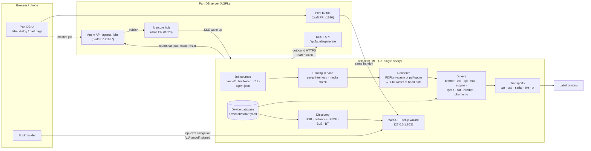
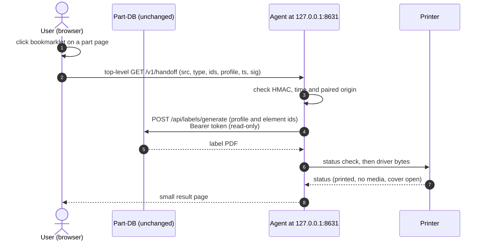
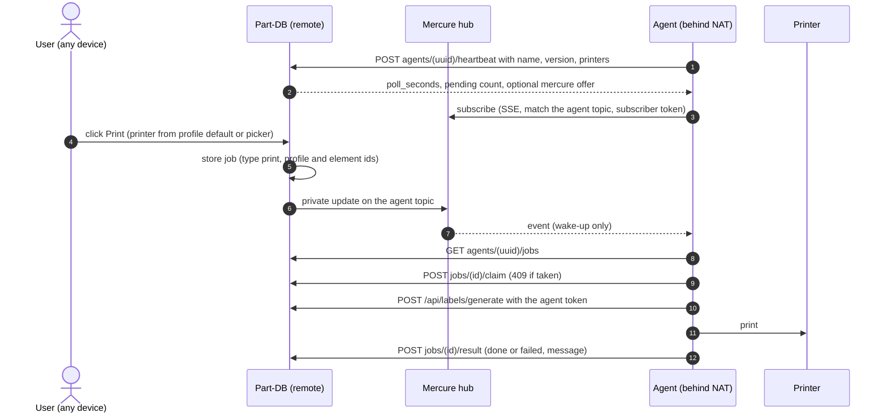
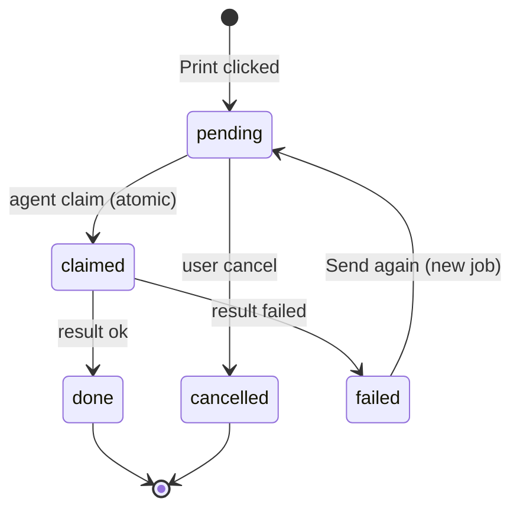
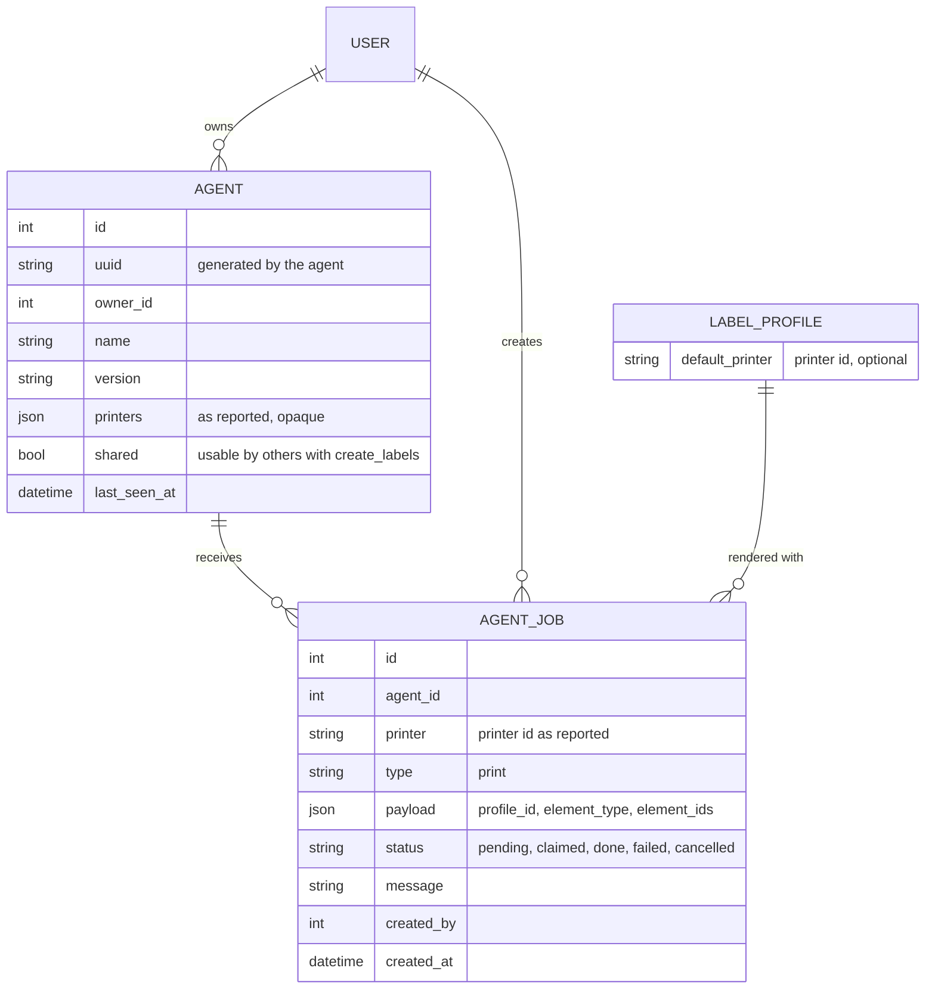

# pdb-print: architecture

*Label print agent for Part-DB. This document describes the design as built (v0.4.1, 2026-11-24) and the
upstream Part-DB changes it is waiting for. Target Part-DB: v2.20.x.*

Which printers are tested on real hardware is in [printers.md](printers.md); how releases are made is in
[releasing.md](releasing.md); the usage report is in [telemetry.md](telemetry.md).

---

## 0. TL;DR

* A **separate, MIT-licensed, single-binary agent written in Go** (`CGO_ENABLED=0`) runs next to the
  printers: on a desktop (Windows per-user install or service, macOS, Linux), or headless on a Pi/NAS
  (`.deb` with a systemd service, or Docker). It owns *everything* printer-specific: rasterising Part-DB's
  PDF to native printhead dots, media checks, vendor protocols (Brother QL/PT raster, ZPL, EPL2, TSPL,
  ESC/POS, DYMO LabelWriter, Niimbot, Phomemo, BLE "cat printers") and transports (TCP 9100, USB, serial,
  Bluetooth LE, Bluetooth Classic RFCOMM).
* **Works with Part-DB as it is today:** the agent fetches PDFs through the existing
  `POST /api/labels/generate`, which a **read-only** API token is enough for. Jobs reach it via a signed
  bookmarklet (a *top-level navigation* to the local agent, so Part-DB's CSP and Chrome's Local Network
  Access don't apply), a hot folder that prints `label_*.pdf` downloads, or the CLI. This works with a
  remote Part-DB too, because the agent fetches outbound.
* **Upstream:** proposal [Part-DB-server#1625](https://github.com/Part-DB/Part-DB-server/issues/1625) with
  four draft PRs from us: a Print button that hands labels to the local agent (#1626), server-side agent
  jobs that an agent polls outbound, so printing works from any device and through NAT (#1627), instant
  delivery via Mercure (#1628) and MCP print tools (#1653). The agent already speaks the job API and the
  Mercure subscription; with an unpatched Part-DB that part stays off. **No printer-specific code lands in
  Part-DB.**
* Rendering uses **PDFium compiled to WebAssembly (go-pdfium + wazero)**: BSD/Apache-licensed, no cgo,
  sandboxed. On 32-bit ARM it runs poppler's `pdftoppm` as a separate process when installed (much faster
  there). MuPDF (AGPL) and GPL printer libraries are never linked; protocols are implemented clean-room
  from vendor references and permissively licensed projects.

---

## 1. Context and verified facts

| Topic | Fact (verified in Part-DB 2.20.4 source) | Design consequence |
|---|---|---|
| Label model | `LabelOptions` (embedded in `LabelProfile`) = `width`, `height` (mm), `barcode_type`, `picture_type`, `supported_element`, `additional_css`, `process_mode`, `lines`. No DPI, rotation, cut, printer or media. | The agent infers orientation and media from the page size and the printer's loaded media (§5.2). |
| PDF API | `POST /api/labels/generate {profileId, elementIds:"1,5-10", elementType?}` → PDF. Checks `@labels.create_labels`, `read` on the profile and on each element. | The one Part-DB call the agent needs. |
| Token scope | `labels.create_labels` and `labels.read_profiles` have `apiTokenRole: ROLE_API_READ_ONLY`. | **A read-only API token is enough.** |
| Other API | `GET /api/tokens/current`, `GET /api/info`, `GET /api/label_profiles`. | Token check and profile picker in the web UI. |
| CSP | `default-src 'self'`, `block-all-mixed-content`, referrer policy `no-referrer`. | A page `fetch()` from Part-DB to `http://127.0.0.1:…` is blocked. Use top-level navigation or server-side jobs. No `Referer` for origin checks. |
| Label dialog | Download filenames start with `label_` (`label_<Type><id>…pdf`). | The hot folder matches `label_*.pdf`. |
| Companion precedent | `BrowserPluginSettings`: a settings class, default off, env override, HTTP 451 when disabled. | The upstream PRs follow the same pattern. |
| Maintainer stance | #489: direct printing needs "a browser plugin or companion app". #1195: a Brother QL with an exact-size PDF. | Part-DB's HTML/PDF stays the single source of truth; ZPL/EPL/TSPL are only bitmap carriers. |
| Proven pipeline | QL-810W + DK-22210 (29 mm continuous): a 29×46 mm portrait PDF with CSS-rotated content, rendered to exactly 306 head dots, sent as Brother raster to TCP 9100. AirPrint mangles the scaling. | Render at native dots and never let a driver scale. |

---

## 2. Goals and non-goals

**Goals**
1. Click "Print" (bookmarklet now, Part-DB's own button with the upstream PRs) and get a crisp, correctly
   sized label within a few seconds, also with a remote Part-DB.
2. One agent for many brands, transports and media; a new model of a known family is data, not code.
3. Installable by non-technical hobbyists on Windows, macOS and Linux; headless on a Pi/NAS.
4. A minimal, opt-in, vendor-neutral footprint in Part-DB, with PRs written and maintained by us.
5. MIT licence; no AGPL/GPL code linked in.

**Non-goals**
* No label design language. Part-DB's HTML/Twig → PDF stays the only template system.
* No printer drivers in Part-DB, and no printing from the Part-DB server process itself (run the agent's
  Docker image next to Part-DB instead).
* No cloud relay operated by us. The relay is the user's own Part-DB instance.
* No exposure of the agent to the internet. The one network-facing surface is the setup window (§10).
* Office printers, A4 label sheets and the OS print queue are out of scope for now: label printers only.

---

## 3. System overview

### 3.1 Architecture diagram



### 3.2 Components

| Component | Package | Responsibility |
|---|---|---|
| CLI and daemon | `cmd/pdb-print` | `serve`, `print`, `render`, `printers`, `media`, `discover`, `report`, `try`, `pair`, `telemetry`, Windows `install`/`uninstall`. |
| Config | `internal/config` | YAML config (§5.1); token in the OS keychain where there is one. |
| Part-DB client | `internal/partdb` | `/api/labels/generate`, label profiles, token check; agent job API and Mercure subscriber. |
| Web UI + local API | `internal/server` | Connect Part-DB, printers, profile routes, test print, bookmarklet, `/v1/handoff`, setup wizard and setup window. |
| Job sources | `internal/source/hotfolder`, `internal/source/agentjobs` | Hot folder; server-side agent jobs. |
| Printing service | `internal/printing` | Per-printer lock, model and media resolution, rendering, dispatch to the driver, online state. |
| Renderer | `internal/render` | PDF → 1-bit raster at native dots (§6). |
| Drivers | `internal/driver/<family>` | Encode, send, pace and confirm; parse status (§7). |
| Transports | `internal/transport/<kind>` | Byte pipes with read-back where the link has one. |
| Bluetooth | `internal/blecore`, `bleradio`, `blebridge`, `cmd/pdb-print-ble` | Shared BLE/Classic code; the macOS cgo helper and its stdin/stdout protocol. |
| Device database | `internal/devicedb` | Models and media as embedded YAML; generates the tables in `docs/printers.md`. |
| Discovery | `internal/discovery`, `internal/snmp` | Passive printer search (§8); SNMP status for network Brother QLs. |
| Support tools | `internal/report`, `internal/try`, `internal/pdfgen` | Redacted printer report for issues; guided first print; generated test labels. |
| Updates | `internal/update`, `internal/selfupdate`, `internal/wininstall` | Daily release check; Windows self-update; Windows install and service. |
| Usage report | `internal/telemetry`, `cmd/pdb-print-stats` | Opt-in weekly anonymous report and its collector (§14). |

---

## 4. Job flows

### 4.1 Local flows (Part-DB unchanged)

1. **Navigation handoff (bookmarklet; Part-DB's Print button with #1626).** A top-level window on
   `http://127.0.0.1:8631/v1/handoff` with `src` (Part-DB origin), `type`, `ids`, `profile`, `ts` and
   `sig` = HMAC-SHA256 with the per-install pairing key. The agent checks the signature and the time
   (±120 s) and calls `/api/labels/generate` with *its own* token. The small page prints right away when
   the signature is valid and asks for a click otherwise. It works against a **remote** Part-DB, and isn't
   affected by Part-DB's CSP (`connect-src` doesn't govern navigation) or by Chrome's Local Network Access
   prompt (which gates fetches and subresources, not top-level navigation). It prints a *saved profile*;
   unsaved dialog edits aren't included.
2. **Hot folder.** With `hot_folder.enabled`, `serve` watches a folder (default `~/Downloads`, pattern
   `label_*.pdf`; files older than 60 s are ignored), prints to the configured printer and moves the file
   to `printed/` or `failed/`.
3. **CLI.** `pdb-print print --profile 2 --ids 32,112-125 [--printer ql810]`, or
   `pdb-print print label.pdf --printer ql810`.



### 4.2 Server-side agent jobs (draft PRs #1627 and #1628)

With a Part-DB that has the agent API (under `/<locale>/agent-api/v1`, like the KiCad API), Part-DB's
Print buttons create a job for a printer the agent reported, from any device. The agent only connects
outbound. Without the API (a 404 on the heartbeat) the loop stays idle and checks again every 5 minutes.



* The heartbeat runs every `poll_seconds` (default 30 s, clamped to 5 s–10 min; once a minute at most while a
  push subscription works, which keeps the agent shown online). It carries each printer's id, name, model,
  media and `online` state.
* A job holds `{profile_id, element_type, element_ids}`, not a PDF: the agent renders it through
  `/api/labels/generate` with its owner's token. Only the owner (or, for an agent its owner shared, users
  with `labels.create_labels`) can send jobs to it.
* A job is claimed right before printing, and a claimed job is finished even during shutdown. Results
  Part-DB didn't accept are retried every round (in memory only).
* Mercure is a wake-up signal only: every event, and every reconnect, starts a normal poll round, so a
  missed event can't lose a job. A subscription silent for 2 minutes is dropped and retried.

### 4.3 Job states (Part-DB side)



A claimed job without a result after 10 minutes shows as "unknown"; it is never re-queued automatically,
so a label is never printed twice. Finished jobs older than 30 days are pruned.

---

## 5. Data model

### 5.1 Agent config

YAML in `<OS config dir>/pdb-print/config.yaml` (the `.deb` service: `/var/lib/pdb-print/config.yaml`;
Windows service: `%ProgramData%\pdb-print`). The web UI writes it; `config.example.yaml` documents every
key.

```yaml
instances:                         # the Part-DB to fetch labels from
  - id: home
    base_url: https://partdb.example.org
    # token: kept in the OS keychain; in the file (0600) only where there is none (Docker, headless)
    # pairing_key: signs bookmarklet handoffs
agent_id: 3f0c…                    # random UUID for the agent job API, stable across token changes

printers:
  - id: ql810
    name: Brother QL-810W
    model: QL-810W                 # device database id; picks the driver
    transport: {kind: tcp, host: 192.168.1.50, port: 9100}
    media: auto                    # the roll the printer reports decides; an id is a fallback
    media_allowed: [dk-22210, dk-22214, dk-11204]
    rotate: auto                   # auto | 0 | 90 | 180 | 270
    cut: per_label

routes:                            # Part-DB label profile → printer
  - profile: 2
    printer: ql810

hot_folder: {enabled: false, dir: ~/Downloads, pattern: "label_*.pdf", printer: ql810}
# update_check, self_update, telemetry, pdftoppm, log_level: see config.example.yaml
```

Transport kinds and their keys: `tcp` (`host`, `port`), `usb` (`usb_id` + `serial`, looked up at every job,
or `device`), `serial` (`device`, `baud`, `framing`, `flow`), `ble` (`address`, `name`), `bt` (`address`,
`name`, `channel`). Which kinds a printer allows comes from its model.

Media and models are not in the config: they live in the device database (`internal/devicedb/data/*.yaml`).
A model has its driver family, dialect, dpi, head pins, allowed transports, how to recognise it (USB id,
IEEE 1284 model, SNMP description, Bluetooth name), quirks and a `tested` note. A media entry has its
geometry, print area and offsets, unprintable edges and the models that take it.

### 5.2 Mapping a Part-DB label profile to media

| Part-DB (`LabelOptions`) | Agent use |
|---|---|
| `width`, `height` (mm) = PDF page size | Matched against the loaded media. Continuous: one side must be the tape width (±0.6 mm); that side becomes cross-feed and the page is turned if needed (`rotate: auto`), the other side is the length. Die-cut: width ±0.6 mm and length ±1 mm. A label that doesn't fit is refused with `MEDIA_MISMATCH`, unless `allow_scaling: true`. |
| `supported_element` | Validates the handoff's element type. |
| `lines`, `additional_css`, barcode and picture types | Opaque; rendered by Part-DB. |

The loaded media comes, in order, from the printer's status (Brother QL/PT report the roll), from the roll
it reported in the last 30 s, or from the config's `media` fallback; it is checked against `media_allowed`.
The proven case: a 29 × 46 mm portrait profile with CSS-rotated content on DK-22210 gives 306 cross-feed dots
and 46 mm feed length, with no rotation needed.

### 5.3 Upstream model (draft PR #1627)

Kept generic: no vendor, DPI or protocol fields. Printer data is stored as reported, without interpretation.



No new permissions: registering an agent and sending it jobs needs `@labels.create_labels`, which a
read-only token has. Agents and jobs are visible to their owner (and the sender, for shared agents).

---

## 6. Rendering pipeline

```
PDF ──► PDFium (wasm) or pdftoppm ──► page at exact head dots ──► threshold ──► rotate / mirror ──► trim to print area ──► driver
```

1. **Size the target exactly.** Cross-feed dots = media width × model dpi, clamped to the printable dots
   (QL 29 mm → 306); the feed axis likewise, or the page's aspect ratio on continuous media. The page is
   rendered straight to that size, never rendered large and resampled, because resampling smears QR
   modules.
2. **No anti-aliasing** (PDFium's no-smooth text/image/path flags, plus print mode), so barcodes stay
   hard-edged at 203 dpi.
3. **Threshold** to pure black/white (configurable `threshold`). No dithering.
4. **Orientation:** `rotate: auto` per §5.2, else explicit; `mirror` and `upside_down` on top (set by the
   setup wizard's test print).
5. **Print area:** on tape with unprintable edges the label is rendered at full width and the edges are
   trimmed, with a warning in the job result when ink was lost.
6. **Limits:** 10 MB per PDF, 500 pages, 256 MiB of raster per call.
7. **Engines:** PDFium runs in wazero, compiled once and cached on amd64/arm64. On 32-bit ARM wazero only
   interprets (minutes per label on a Pi 1), so `pdftoppm: auto` runs poppler's `pdftoppm` as a process
   when it is installed (`install.sh` installs it there); it is never linked.

Golden PNGs in `internal/render/testdata` pin the output of the sample PDFs.

---

## 7. Drivers and transports

### 7.0 How it is wired

* **Device database** (`internal/devicedb`, YAML embedded in the binary): models and media (§5.1). A model
  an existing family can print is a data change only.
* **Driver registry** (`internal/driver`): families register in `init`; a driver is built per printer
  from its model and options and owns the whole flow after rendering: `Status`, `Print` (encode, send,
  pace, confirm) and `Encode` (for `--dry-run`).
* **Transport registry** (`internal/transport`): kinds register in `init`. The printing service hands
  drivers a connection that opens on first use, so a QL that answers over SNMP never gets a TCP
  connection just for a status check. Registration only runs when the binary imports the package (blank
  imports in `internal/printing/printing.go`).
* **Printing service** (`internal/printing`): per-printer lock, model and media resolution (§5.2),
  rendering, dispatch to the driver. The heartbeat's `online` state is checked at most every 30 s, never
  while a printer prints.
* Jobs end as *printed* (confirmed by the printer), *sent (unconfirmed)* (no read-back, or the printer
  stayed silent), or an error with a status code (§9).

### 7.1 Interfaces

```go
// internal/driver/driver.go
type Driver interface {
    Status(ctx context.Context, t Transport) (*Status, error)  // ErrNoReadback if it can't say anything
    Print(ctx context.Context, t Transport, job *Job) (*Result, error) // validate, encode, send, confirm
    Encode(w io.Writer, job *Job) error                        // the bytes Print would send (--dry-run)
}

type Transport interface {
    Open(ctx context.Context) error
    Write(p []byte) (int, error)
    Read(p []byte) (int, error) // ErrNoReadback (or a timeout) if nothing comes back
    Close() error
    Kind() string
}
```

### 7.2 Drivers

Every model with its test status: [printers.md](printers.md).

| Family | Dialects / models | Transports | Status and confirmation | Source |
|---|---|---|---|---|
| `brother` | `ql`: QL-5xx…8xx and wide QL-10xx/11xx (QL-810W tested); `pt-cbp`: PT-9500PC (tested); `pt-raster`: PT-E550W, P750W, P710BT, P700, E500, P900 series | tcp, usb, bt (PT-P710BT/P910BT) | 32-byte status (media width/type, errors); network QLs over SNMP, since they don't answer status on 9100 | Brother Raster Command Reference; PT-9500PC CBP-RASTER reference |
| `zpl` | Zebra desktops (GK420d community-tested), ZT industrial, ZQ mobile | tcp, usb, serial, bt (ZQ) | `~HS`; waits for the buffer to empty | Zebra ZPL II guide |
| `epl` | EPL2-only LP/TLP 2824, 2844, 3842, 2722/2742 … | usb, tcp, serial | `^ee` over USB/serial; TCP is blind | Zebra EPL Programming Guide |
| `tspl` | TSC and clones (Xprinter, Munbyn, iDPRT, HPRT) | usb, tcp, bt | `<ESC>!?` byte; waits for "printing" to clear | TSC TSPL/TSPL2 manual |
| `escpos` | REGO RG-MLP80B, generic 58/80 mm | bt | `DLE EOT`; `GS r 1` after a job | Epson ESC/POS reference |
| `dymo` | `lw400`: LabelWriter 400/450 series, 4XL; `lw300`: 330 | usb, serial (330) | `ESC A` byte; never confirms a finished label | DYMO LabelWriter 400/450 Technical Reference |
| `cat` | `gb`: GB01–03, GT01, YT01, MX05–MX10 (MX10 tested) | ble | none | public cat-printer write-ups |
| `niimbot` | `b1`, `b21`, `d11`, `d110`, `v4`: B1, B21, B21S (tested), B18, D11, D110, D101, Pro models | ble, serial (B21S USB) | heartbeat (cover, paper, battery), RFID roll info; print-end confirmation | niimbluelib (MIT), printers.niim.blue (facts only) |
| `phomemo` | `m02`, `m110`, `d30`: M02/T02, M110–M221, Q30, D30/D35 | ble | paper and cover replies; counts printed pages | MIT/Apache projects; phomemo-tools (GPL) never read |

Not supported: DYMO LabelWriter 5xx (chip-locked labels), DYMO LabelManager, office printers and the OS
print queue, IPP. Exec plugins for external GPL tools were considered and not built.

### 7.3 Transports per OS

| Kind | Linux | macOS | Windows |
|---|---|---|---|
| `tcp` (raw 9100) | ✓ | ✓ | ✓ |
| `usb` | usblp `/dev/usb/lpN`, found by `usb_id` in sysfs | IOUSBHost in the helper `pdb-print-usb`, found by `usb_id` | usbprint.sys (inbox "USB Printing Support"), found by `usb_id` among the `GUID_DEVINTERFACE_USBPRINT` interfaces |
| `serial` | `/dev/serial/by-id/…`, `/dev/ttyUSB0`, Pi UART | `/dev/cu.*` | `COMn` |
| `ble` | BlueZ over D-Bus | CoreBluetooth in the helper `pdb-print-ble` | WinRT, in-process (BLE adapter needed) |
| `bt` (Classic RFCOMM) | RFCOMM socket; BlueZ for name lookup and scan | IOBluetooth in the helper | Winsock Bluetooth socket, SDP lookup |

USB on Linux: usblp opens non-blocking, so empty reads return 0 bytes (poll) and `poll(POLLOUT)` drains the
last write before close. USB on Windows is pure Go (`golang.org/x/sys/windows`): SetupAPI/CfgMgr list the
usbprint interfaces (the serial is on the parent devnode for composite devices), `IOCTL_USBPRINT_GET_1284_ID`
reads the device id, and reads and writes are overlapped and cancelled with `CancelIoEx` at the read
deadline or after 30 s without progress on a write chunk. usbprint doesn't lock the device: the Windows
spooler can print to it at the same time. Windows starts an interface that also offers IPP over USB (7/1/4 next to 7/1/2,
e.g. the QL-810W) in that protocol, where the printer ignores raster data: a job switches it to BIDI with
`IOCTL_USBPRINT_SET_PROTOCOL` and back on close, so Windows' own IPP queue keeps working. USB on macOS goes through the cgo helper `cmd/pdb-print-usb`
(IOUSBHost; no kernel driver binds a printer interface there): `pdb-print-usb list` gives the USB devices
with a printer-class interface (`iokit:0x…` registry ids of the devices), and a job runs the helper in bridge mode with the same `internal/blebridge`
protocol (Kind `usb`), through the Bluetooth helper's client. It is a helper of its own because the Bluetooth
library asks for Bluetooth permission whenever its process starts. A printer is a USB device whose
`UsbDeviceSignature` (every interface class of the device) includes a raster printer class (7/1/1 or 7/1/2);
the helper opens that interface at job time. macOS's own driverless queue (IPP over USB, the QL-810W's
alternate setting 7/1/4) holds the interface for up to ~10 s after its jobs and leaves it on the IPP setting
meanwhile: the helper counts both as busy and retries for 15 s, then
holds the printer 5 s more while it finishes the queue's label (it answers status only then). It never switches the setting itself:
switching it right after a queue job left the QL-810W silent on raster until it was power-cycled. The online check only
looks for the printer in the list, so it never takes the interface. Writes go in 64 KiB chunks, each with
30 s to leave; a printer without a bulk IN endpoint reports no read-back. On macOS all Bluetooth goes through `cmd/pdb-print-ble`, the only cgo
binary: `pdb-print` starts it on demand and talks to it over stdin/stdout (`internal/blebridge`), so only
the helper asks for Bluetooth permission. Docker has no Bluetooth. A Bluetooth printer takes one connection
at a time.

---

## 8. Discovery

`pdb-print discover`, the setup wizard and `pdb-print report` use `internal/discovery`. It is passive:
nothing printable is sent.

| Method | What it finds |
|---|---|
| USB (Linux sysfs, Windows usbprint.sys, macOS `pdb-print-usb list`) | printer-class USB printers: USB id, serial, IEEE 1284 device id |
| Network | hosts on the local subnets (each at most a /24) with port 9100 open, named from SNMP `sysDescr` |
| Bluetooth LE | advertised names matching a model, and unknown devices with the cat printers' service `ae30` |
| Bluetooth Classic | paired/known devices and an inquiry: names matching a model, or a printer class of device |
| Serial | the ports present (what is plugged in can't be told) |

Each candidate is matched against the device database and shown with the exact `model:` and `transport:`
lines. Asking a printer what it is (a few bytes a printer of another language might print) is left to
`pdb-print try`, the setup wizard and `report --identify`, which ask first.

---

## 9. Status and errors

**Status codes** (`internal/driver`, stable keys so Part-DB can show them): `OK`, `BUSY`, `NO_MEDIA`,
`MEDIA_MISMATCH`, `MEDIA_END_SOON`, `COVER_OPEN`, `CUTTER_JAM`, `PAPER_JAM`, `OVERHEAT`, `LOW_BATTERY`,
`PAUSED`, `RIBBON_OUT`, `COMMS_ERROR`, `UNSUPPORTED`, `RENDER_ERROR`, `UNKNOWN`.

* **Pre-flight:** before encoding, the agent reads the printer's status and compares the job's page size
  with the loaded media, so a wrong roll fails fast without wasting labels.
* **No local queue:** a job runs while its caller waits; the per-printer lock serialises jobs. Retrying is
  the caller's business (the bookmarklet page, Part-DB's "Send again", the hot folder's `failed/`). During
  a self-update, pending agent jobs are left unclaimed until the new version runs.
* **Reporting upstream:** the job result message (e.g. `MEDIA_MISMATCH: label is 29×46 mm (needs 29 mm
  tape), printer has dk-22214 (12 mm tape) loaded`) and each printer's media and online state in the
  heartbeat.

---

## 10. Security

**Agent local surface**
* `serve` binds **loopback only** (`127.0.0.1:8631`, also `[::1]`); other addresses are refused. Foreign
  `Host` headers are rejected (DNS rebinding), every POST needs a CSRF token, and session cookies are
  HttpOnly and `SameSite=Strict`.
* **Setup window:** `serve --setup-window` (systemd unit, Docker; only while no Part-DB is set up) and
  `pdb-print pair` open the setup wizard to the LAN: a second HTTP server listens on each LAN address of
  port 8631 and serves only `/setup/*` and static files. A 6-digit code (logged, printed by `pair`) gives
  the browser an HttpOnly SameSite=Strict session cookie with its own CSRF token. The code is single-use:
  it pairs one browser, and another browser needs a new window (`pdb-print pair`); once it is used, further
  tries neither pair nor count, so nobody on the LAN can close the window on the paired browser. The window
  closes after 15 minutes without use (each request extends it to at least 5 more, never beyond 30), after
  5 wrong codes before the code is used, or on Finish; closing stops the listeners and drops their
  connections. `/v1/pair` answers only loopback requests without an `Origin`. A source-address filter turns
  away obviously remote clients: it answers only private, unique-local, link-local and loopback addresses
  and the IPv6 /64 of one of the host's interfaces, never public IPv4 subnets. It is not a trust boundary:
  routed private networks and a provider's /64 pass it, and so does every device on the LAN. The code and
  the time limit are the protection; limiting TCP port 8631 to trusted sources is the operator's job.
  Requests must also name one of the host's addresses or `<hostname>.local` (DNS rebinding). Wherever
  untrusted machines can reach the host, port 8631 must be limited to trusted sources before installing, or
  setup kept on loopback: run `serve` without `--setup-window`, don't run `pdb-print pair`, and use the web
  UI at http://127.0.0.1:8631 on the host. The token travels over plain HTTP on the LAN during the window.
* **Windows service:** the web UI asks every browser for a code from `pdb-print pair`; a paired browser
  stays signed in for 30 days, and "Sign out all browsers" (or reinstalling the service) ends every session.
  This keeps other users of the PC from casually changing settings; it doesn't stop a determined local user.
* **Pairing key** (256-bit, per Part-DB instance) signs handoffs (HMAC, `ts` ±120 s); unsigned or stale
  handoffs need a click on the agent's page. The web UI can rotate it, which regenerates the bookmarklet.
* **PDF parsing runs inside PDFium-wasm**, so a malicious PDF can't leave the wasm sandbox. (`pdftoppm`
  on 32-bit ARM parses natively; `pdftoppm: off` turns it off.)
* The agent fetches documents only from its configured Part-DB, over verified TLS (plain HTTP only with
  `allow_http` or for loopback); the same rule applies to the Mercure hub.

**Credentials**
* A **read-only** Part-DB API token. Stored in the OS keychain (zalando/go-keyring: Windows Credential
  Manager, macOS Keychain, Secret Service); without one (Docker, headless, service) in the config file
  (0600) or `PDB_PRINT_TOKEN`.

**Upstream (draft PRs)**
* No new permission group: agent endpoints need `@labels.create_labels` and act only on agents owned by the
  token's user. An agent sees only its own jobs.
* Mercure: **private** updates on a per-agent topic carrying no document data; the subscriber token comes
  with the heartbeat, is short-lived and limited to that topic.

---

## 11. Push transport and its fallback

| Option | Verdict |
|---|---|
| **Short polling** of `agents/{uuid}/jobs` every `poll_seconds` (default 30 s); the heartbeat's `pending` count skips the listing when there is nothing | **Default.** Cheap on php-fpm: no held worker. |
| **Mercure** (draft PR #1628): Part-DB publishes a private update per job; the agent subscribes with `?match=` (Mercure 1.x) | **Instant delivery** (under a second) when a hub is configured. The FrankenPHP image has a hub built in (the PR fixes its Caddyfile for Mercure 1.x); the Apache image needs a `dunglas/mercure` sidecar. |
| Long-poll or SSE in PHP | Rejected: holds one of about 5 php-fpm workers per agent. |
| WebSocket | Rejected: no benefit over SSE here. |

---

## 12. Upstream changes

Proposal: [Part-DB-server#1625](https://github.com/Part-DB/Part-DB-server/issues/1625) (posted 2026-10-27).
Stacked draft PRs from `francisrath/Part-DB-server`, awaiting the maintainer's review. All follow the
`BrowserPluginSettings` pattern (settings class, default off, env override).

| PR | Content |
|---|---|
| [#1626](https://github.com/Part-DB/Part-DB-server/pull/1626) Print button | A browser is connected once to the local agent (URL and pairing key in `localStorage`, via a fragment link from the agent's web UI). A Print button in the label dialog and printer icons in the "Label" menus open the agent's `/v1/handoff`, signed with WebCrypto. No CSP change. |
| [#1627](https://github.com/Part-DB/Part-DB-server/pull/1627) Agent jobs | `Agent` and `AgentJob` entities, the agent API (§4.2), a "Print agents" page (printers, state, jobs, Send again, share), a default printer per label profile, and a printer picker in the label dialog. Works through NAT with polling. |
| [#1628](https://github.com/Part-DB/Part-DB-server/pull/1628) Mercure | Private per-agent updates and subscriber tokens in the heartbeat; fixes the FrankenPHP Caddyfile for Mercure 1.x. |
| [#1653](https://github.com/Part-DB/Part-DB-server/pull/1653) MCP | MCP tools `print_labels` and `get_label_printing_options`, which create agent jobs. |

**What stays out of Part-DB:** drivers, DPI, media catalogues, rasterisation, vendor names, Bluetooth/USB,
discovery, installers.

---

## 13. Language and libraries

**Go**, for a single static binary from one cross-compiling build (GoReleaser), cgo-free PDF rendering via
wasm PDFium (a sandboxing bonus), cgo-free Windows APIs through `x/sys/windows`, BLE on all three OSes, and
a low contributor barrier. Rust was the credible alternative; Python's printer ecosystem is mostly GPL,
which we couldn't link anyway. The only cgo is the macOS Bluetooth helper, built on a macOS runner.

### 13.1 Licensing

| Component | Licence | Use |
|---|---|---|
| **pdb-print** | **MIT** | — |
| PDFium / go-pdfium / wazero | BSD-3 / MIT / Apache-2.0 | embedded wasm renderer |
| tinygo bluetooth, godbus | BSD-3, BSD-2 | BLE; BlueZ over D-Bus |
| gosnmp | BSD-2 | Brother QL status over SNMP |
| zalando/go-keyring | MIT | token storage |
| boombuler/barcode | MIT | QR and Code 128 on generated test labels |
| Poppler (`pdftoppm`) | GPL-2/3 | only run as an external program, never linked or shipped |
| MuPDF | AGPL-3.0 | ✗ not used |
| brother_ql, phomemo-tools, GPL cat-printer projects | GPL | ✗ not copied or read; protocols from vendor references |
| niimbluelib | MIT | protocol reference |
| Part-DB | AGPL-3.0 | separate program over HTTP; the upstream PRs are AGPL as part of Part-DB |

---

## 14. Installation, updates, runtime modes

| Platform | Package | Runs as |
|---|---|---|
| Windows x64 | `setup.exe` (Inno Setup) or zip + `pdb-print install` | per-user: login autostart without a window (`pdb-printw.exe`); or the Windows service `pdb-print` for all users. Unsigned for now (SmartScreen warns). |
| macOS universal | Homebrew cask (`francisrath/tap`), tar.gz | `pdb-print serve`; `pdb-print-ble` and `pdb-print-usb` next to it. Developer-ID signed and notarised. |
| Debian, Ubuntu, Raspberry Pi OS | `.deb` via `install.sh` (checks `checksums.txt`) | systemd service as user `pdb-print` (groups `lp`, `bluetooth`, `dialout`); `--setup-window` until set up. |
| Headless, any Linux | Docker `ghcr.io/francisrath/pdb-print` (amd64, arm64); archives incl. `linux_armv6` | container with `--network host`, setup window on first start; no Bluetooth. |

**First run:** a setup wizard (on the host at `http://127.0.0.1:8631`, or through the setup window from
another machine) connects Part-DB with a read-only token, finds printers, prints a test label, asks how it
came out (setting `mirror`/`upside_down`), names the printer and asks about the usage report.

**Updates:** `serve` asks GitHub once a day for the latest release (no data sent) and the web UI shows the
notes and how to update this install. The Windows install updates itself ("Update now": downloads the zip,
checks `checksums-windows.txt`, swaps the exes once no label is printing, restarts); `self_update: false`
turns it off. Other installs update through their package manager or image.

**Releases** (`docs/releasing.md`): a `v*` tag runs GoReleaser on Ubuntu (Linux archives, `.deb`, Docker),
on macOS (signed and notarised binaries, Homebrew cask) and on Windows (`setup.exe`). Each release carries
`checksums.txt`, an SPDX SBOM and signed build provenance (`gh attestation verify`).

**Usage report:** opt-in (asked in the wizard), weekly, anonymous: version, OS, printer models and
connection types, job and label counts ([telemetry.md](telemetry.md)). The collector `cmd/pdb-print-stats`
ships only as a Docker image.

---

## 15. Multiple agents, printers, users

* Several agents per Part-DB instance (workshop PC, Pi in the garage, laptop), each with its own
  `agent_id`. A printer's identity upstream is (agent, printer id).
* The Part-DB side picks the printer: the job's printer, else the profile's default printer (an id; each
  user's own agent reporting it wins, then shared agents), else the picker.
* Locally, `routes` map a label profile to a printer for the bookmarklet and the CLI.

---

## 16. i18n

The web UI is English only. Status codes are stable keys (§9), so Part-DB can translate them; the result
message is free-form detail.

---

## 17. Testing strategy

1. **Golden rasters:** sample Part-DB PDFs rendered and compared with checked-in PNGs (`-update` rewrites).
2. **Golden bytes:** drivers encode fixed rasters and are compared byte for byte with goldens.
3. **Fakes, never hardware:** fake TCP printers, pipes, pseudo-terminals for serial, fake BLE/Classic
   radios and a fake helper process. Hardware status checks sit behind the `hardware` build tag.
4. **Device database checks:** `go test ./internal/devicedb` validates the YAML and fails when
   `docs/printers.md` needs regenerating.
5. **CI** (`.github/workflows/ci.yml`): `go test -race` on Linux, macOS and Windows, coverage, gofmt,
   staticcheck, govulncheck, `goreleaser check`, and packaging jobs that build and inspect the `.deb`,
   macOS archive and `setup.exe`. The required check is `ci`; docs-only changes skip the heavy
   jobs.
6. **On real printers:** `pdb-print try` (guided test with a report file) and `pdb-print report` for
   community testers; the author's bench in [printers.md](printers.md).

---

## 18. Repository, governance, licence

* **Repo:** [github.com/francisrath/pdb-print](https://github.com/francisrath/pdb-print) (renamed from
  partdb-print-agent in 2026-11), separate from Part-DB.
* **Layout:** `cmd/pdb-print`, `cmd/pdb-print-ble`, `cmd/pdb-print-usb`, `cmd/pdb-print-stats`; `internal/…` (§3.2);
  `packaging/` (deb, docker, windows); `docs/`; `assets/icon/`.
* **Contributing:** `CONTRIBUTING.md`, issue forms, `SECURITY.md`, `CODEOWNERS`. A new model is a device
  database entry; a new family a package under `internal/driver/`; a new connection under
  `internal/transport/`. Printers we don't own get "looking for a tester" issues.
* **Licence:** MIT.

---

## 19. Roadmap

Done (v0.1–v0.4.1, 2026-10 to 2026-11): renderer, bookmarklet handoff, hot folder, CLI, web UI and setup
wizard with setup window, discovery, SNMP status, media from the loaded roll; drivers `brother` (QL, PT),
`zpl`, `epl`, `tspl`, `escpos`, `dymo`, `cat`, `niimbot`, `phomemo`; transports `tcp`, `usb`, `serial`,
`ble`, `bt`; agent job client with Mercure wake-up; Windows installer, service and self-update; Homebrew
cask; `.deb`; Docker; usage report; SBOM and build provenance.

Next:
* Upstream: answer the maintainer on #1625 and the draft PRs; adapt the agent to whatever API lands.
* Hardware: test the untested families as testers or printers turn up (REGO RG-MLP80B, TSPL, EPL2,
  DYMO, P-touch raster, Phomemo).
* Windows code signing (SignPath was declined; reapply later).

Not planned for now: A4 sheets and office printers, IPP, exec plugins, a tray app,
OAuth pairing.

---

## 20. Risks and mitigations

| Risk | Mitigation |
|---|---|
| Maintainer declines the upstream PRs or wants another shape | The agent is fully useful without them (bookmarklet, hot folder, CLI). PRs are small, opt-in and default-off. |
| PHP holding connections exhausts php-fpm workers | Polling by default; Mercure for push; no long-poll. |
| Browser policy changes (Local Network Access, mixed content) | Top-level navigation isn't fetch-gated; server-side jobs need no browser → agent traffic at all. |
| Unsigned Windows binaries | SmartScreen instructions in the README; signing once a programme accepts the project. |
| GPL contamination | Implement from vendor references; `pdftoppm` only as an external process. |
| Printer diversity and clone quirks | Data-driven device database, `pdb-print report` and `try`, tester issues. |
| Untested families | Marked 🟡 in printers.md; results say "sent (unconfirmed)" rather than guess. |
| Raster quality changes with PDFium versions | Golden raster tests; pinned go-pdfium. |
| Slow wasm on 32-bit ARM | `pdftoppm` there; 64-bit OS recommended. |
| A local agent abused by websites | Loopback bind, Host allowlist, CSRF, signed handoffs with a click otherwise. |
| Bus factor (one maintainer) | Simple Go codebase, CODEOWNERS, contributor docs. |

---

## 21. Upstream proposal

Posted 2026-10-27 as [Part-DB-server#1625](https://github.com/Part-DB/Part-DB-server/issues/1625): an
outbound "agent" channel for Part-DB, starting with direct label printing (Print button, agent jobs with a
`type`, optional Mercure push), also argued for live UI updates, pick-by-light (#948, #274) and NAT-friendly
event subscriptions (#1339). Implemented as the draft PRs in §12.

---

## 22. Decisions

| # | Topic | Decision |
|---|---|---|
| 1 | Licence | **MIT** |
| 2 | Repo home | **github.com/francisrath/pdb-print**; hand-over to the Part-DB org can be offered later |
| 3 | Agent job payload | **Profile + element ids**, rendered by the agent with its owner's token (no PDF stored in Part-DB) |
| 4 | Agent token | **Read-only** |
| 5 | Tag inbox | **Dropped** (2026-10-27): tried (closed PR #5), too much hassle; remote printing goes through agent jobs |
| 6 | Signing | macOS: Developer ID, notarised. Windows: unsigned for now (SignPath declined 2026-11-22) |
| 7 | 32-bit ARM | Supported (`linux_armv6`, `.deb`), rendering with `pdftoppm`; 64-bit recommended |
| 8 | Push on Part-DB | Mercure, off unless configured; FrankenPHP's built-in hub, or a sidecar for the Apache image |
| 9 | Name | `pdb-print` (repository and CLI; renamed from partdb-print-agent in 2026-11) |
| 10 | Compatibility | Pre-release: no backwards-compatibility code; breaking config changes go in the release notes |

---

## Sources

**Part-DB source (v2.20.4)**
- `src/ApiResource/LabelGenerationRequest.php`, `src/State/LabelGenerationProcessor.php`: label generation and permission checks
- `config/permissions.yaml` (`labels.create_labels`, `read_profiles` → `ROLE_API_READ_ONLY`), `docs/api/authentication.md`
- `src/Entity/LabelSystem/LabelOptions.php`, `LabelProfile.php`
- `Dockerfile` (Apache + php-fpm), `Dockerfile-frankenphp`, `.docker/frankenphp/Caddyfile` (Mercure directive)
- `config/packages/nelmio_security.yaml` (CSP)
- `src/Controller/BrowserPluginController.php`, `src/Settings/InfoProviderSystem/BrowserPluginSettings.php`
- `templates/label_system/dialog.html.twig`, `src/Controller/LabelController.php` (filename `label_<Type><id>.pdf`)
- Repo: https://github.com/Part-DB/Part-DB-server

**Part-DB issues and discussions:** #489, #746, #946, #1195, PR #1234, #1625, Discussion #1664.

**Browser platform:** Chrome Local Network Access: https://developer.chrome.com/blog/local-network-access

**Libraries:** go-pdfium (https://github.com/klippa-app/go-pdfium), wazero (https://wazero.io),
tinygo bluetooth (https://github.com/tinygo-org/bluetooth), niimbluelib (https://github.com/MultiMote/niimbluelib),
Mercure (https://mercure.rocks/docs/hub/install), FrankenPHP Mercure (https://frankenphp.dev/docs/mercure/).

**Vendor references:** Brother QL/PT Raster Command Reference and PT-9500PC CBP-RASTER reference, Zebra ZPL II
and EPL programming guides, TSC TSPL/TSPL2 manual, Epson ESC/POS reference, DYMO LabelWriter 400/450 Technical
Reference Manuals.
