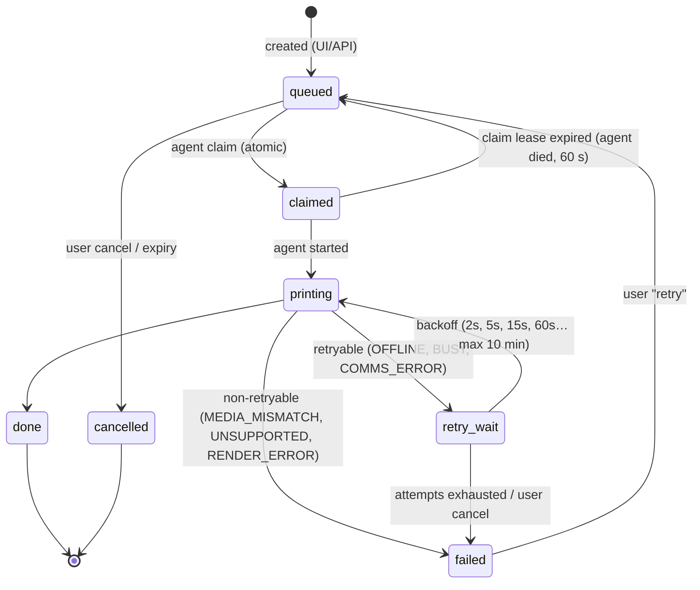
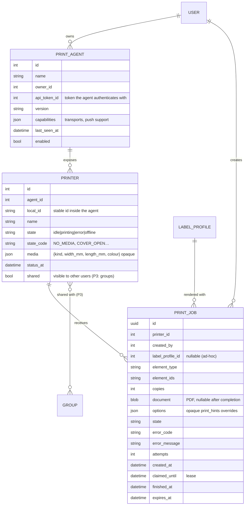

# Part-DB Print Agent: end-to-end architecture proposal

*Working title: **partdb-print-agent** (CLI/daemon name `pdb-print`)*
*Status: draft for internal review, 2026-10-27. Target Part-DB: v2.20.x (verified against 2.20.4 source).*

Legend used throughout: **[MVP]** = first release, no Part-DB changes needed · **[P2]** = phase 2 (first upstream PRs + broader hardware) · **[P3]** = phase 3 (push transport, polish) · **[Later]** = designed for, not scheduled.

---

## 0. TL;DR

* A **separate, MIT-licensed, single-binary agent written in Go** runs next to the printers (desktop tray app, Windows service, LaunchAgent, systemd unit, or Docker container on a Pi/NAS). It owns *everything* printer-specific: rasterising Part-DB's PDF to native printhead dots, media/cut/colour handling, vendor protocols (Brother QL/PT raster, ZPL, EPL2, TSPL, ESC/POS, DYMO, Niimbot, Phomemo) and transports (USB, TCP 9100, IPP, BLE, serial/SPP, OS print queue).
* **Works today with zero Part-DB changes** [MVP]: the agent fetches PDFs through the existing `POST /api/labels/generate` (needs only a **read-only** API token). Jobs reach it via (a) a userscript button in the label dialog, (b) a bookmarklet / link that does a *top-level navigation* to the local agent (sidesteps Part-DB's CSP and Chrome's Local Network Access fetch gating), (c) a "hot folder" that prints `label_*.pdf` downloads, and (d) a CLI. These work with a remote Part-DB too, because the agent fetches labels outbound; only printing from a phone to an agent at home (through NAT) needs the upstream additions below.
* **Instant printing through NAT** [P2/P3] needs a small, opt-in upstream addition in four sequential PRs: (1) a "Send to print agent" button + setting, (2) a `PrintJob` API resource + agent/printer registration (polling works from here on), (3) push via **Mercure** (the FrankenPHP image already ships a hub; the Apache image needs a sidecar hub), falling back to short polling, with an opt-in long-poll, (4) an opaque `print_hints` JSON field on label profiles. **No printer-specific code or schema lands in Part-DB.** The agent always connects *outbound*.
* Rendering uses **PDFium compiled to WebAssembly (go-pdfium + wazero)**. It is BSD/Apache-licensed, needs no cgo and runs sandboxed. MuPDF (AGPL) and Poppler (GPL) are avoided. GPL vendor libraries (brother_ql, phomemo-tools) are not linked; their protocols are re-implemented from vendor specs, or they can be used as optional *external* exec plugins.

---

## 1. Context and verified facts

| Topic | Fact (verified in Part-DB 2.20.4 source unless noted) | Design consequence |
|---|---|---|
| Label model | `LabelOptions` (embedded in `LabelProfile`) = `width`, `height` (mm, float), `barcode_type`, `picture_type`, `supported_element`, `additional_css`, `process_mode`, `lines`. No DPI, rotation, cut, printer, media. | The agent must infer orientation/media from page size + its own media profile. Optional upstream `print_hints` blob (PR4). |
| PDF API | `POST /api/labels/generate {profileId, elementIds:"1,5-10", elementType?}` → PDF (`src/ApiResource/LabelGenerationRequest.php`, `src/State/LabelGenerationProcessor.php`). The processor checks `@labels.create_labels`, `read` on the profile and `read` on each element. | |
| Token scope | In `config/permissions.yaml`, `labels.create_labels` and `labels.read_profiles` have `apiTokenRole: ROLE_API_READ_ONLY`. | **A Read-Only API token is enough** for the agent in the MVP. |
| Other API | `GET /api/tokens/current` (token introspection), `GET /api/info` (version), `GET /api/label_profiles` (filterable by `options.supported_element`, `show_in_dropdown`). | Pairing validation, capability detection, profile picker in the agent UI. |
| OAuth2 | Part-DB is now an OAuth2 AS (league/oauth2-server-bundle), **off by default** (`OAUTH_SERVER_ENABLED`). Auth-code + PKCE; **loopback redirect URIs (127.0.0.1/localhost/::1, any port) explicitly allowed**. Device-code grant disabled. DCR is optional and capped at the `edit` scope. | A nicer pairing path [P2] with no upstream change when the admin has OAuth enabled. Device code would need a config flip (question for the maintainer). |
| Docker | Documented image `jbtronics/part-db1` = Debian + **Apache + php-fpm** (default pool, no tuned `pm.max_children` → Debian default 5). A second image **`partdborg/part-db`** is built from `Dockerfile-frankenphp` (worker mode). Its Caddyfile **already enables the `mercure` directive** (bolt transport, `anonymous`, `subscriptions`, JWT keys from env). | Push is nearly free on FrankenPHP and needs a sidecar hub on Apache. **Long-polling on php-fpm ties up one of about 5 workers per agent**, so it is opt-in only. |
| Push deps | composer.json: no `symfony/mercure-bundle`, no messenger; has `symfony/ux-turbo`, `api-platform/*` 4.x, `api-platform/mcp`, `symfony/mcp-bundle`. | PR3 adds `symfony/mercure-bundle` (or a ~50-line HttpClient publisher if the maintainer prefers fewer deps). |
| CSP | `nelmio_security.yaml`: `default-src 'self'` (so `connect-src` is `'self'`), `block-all-mixed-content`, referrer policy `no-referrer`. | A page-context `fetch()` from Part-DB to `http://127.0.0.1:…` is **blocked by CSP**. Use top-level navigation, a userscript `GM_xmlhttpRequest`, or server-side jobs. No `Referer`, so it can't be used for origin checks. |
| Label dialog | `templates/label_system/dialog.html.twig` embeds the generated PDF as `<object id="pdf_preview" data="data:application/pdf;base64,…">`. Download filename is `label_<Type><id>.pdf`. | The userscript can grab the exact PDF, including ad-hoc dialog options that aren't saved in a profile. The hot folder matches `label_*.pdf`. |
| Companion precedent | `BrowserPluginController` (`/tools/info_providers/browser_info`, `/browser_html`), gated by `BrowserPluginSettings::$enabled` (default **false**, env `BROWSER_PLUGIN_ENABLED`), returns HTTP 451 when disabled. | Copy this pattern exactly for PR1/PR2: a settings class, default off, env override. |
| Maintainer stance | #489: direct printing needs "a browser plugin or companion app". ZPL is limited vs HTML/PDF. #1195: he uses a Brother QL with an exact-size PDF via the driver. | The agent keeps Part-DB's HTML/PDF as the single source of truth and adds no template language. ZPL/EPL/TSPL are used only as **bitmap carriers**. |
| Community | #946 (EPL2 labeller because QR in PDF unscannable at 203 dpi), #746 (CUPS, ptouch-driver, labelle), Tampermonkey + local Python server in #1195. | Validates demand. Unscannable QR is a *rasterisation* problem (anti-aliasing + resampling), which §6 solves. |
| Proven pipeline | QL-810W + DK-22210 (29 mm continuous). The PDF is 29×46 mm portrait with CSS-rotated content. `pdftoppm -scale-to-x 306` gives exact head dots, then the `brother_ql` raster goes to TCP 9100. AirPrint mangles scaling. About 3 mm feed margin at each end. | Golden test case #1. Render at native dots, never let a driver scale. |

---

## 2. Goals and non-goals

**Goals**
1. Click "Print" anywhere (desktop, phone, remote Part-DB) and get a crisp, correctly sized label within about 1–3 s.
2. One agent for many brands, transports and media types, including A4/Letter sheets.
3. Installable by non-technical hobbyists on Windows, macOS and Linux. Headless on a Pi/NAS.
4. Minimal, opt-in, vendor-neutral footprint in Part-DB, with PRs written and maintained by us.
5. Permissive licence for the agent (MIT). No AGPL/GPL code linked in.

**Non-goals**
* No new label design language. Part-DB's HTML/Twig → PDF stays the only template system.
* No printer drivers inside Part-DB, and no printing from the Part-DB server process itself. (A server-side "agent" is still possible: run the agent's Docker image next to Part-DB on the same LAN.)
* No cloud relay operated by us (PrintNode style). The relay *is* the user's own Part-DB instance.
* No exposure of the agent to the internet, ever.

---

## 3. System overview

### 3.1 Architecture diagram

```mermaid
flowchart LR
  subgraph Browser["Browser / phone"]
    UI["Part-DB UI<br/>label dialog / part page"]
    US["Userscript / bookmarklet<br/>[MVP]"]
  end

  subgraph PDB["Part-DB server (AGPL, unchanged in MVP)"]
    API["REST API (API Platform)<br/>/api/labels/generate"]
    PJ["PrintJob / PrintAgent / Printer<br/>resources [P2, PR2]"]
    HUB["Mercure hub [P3, PR3]<br/>FrankenPHP built-in or sidecar"]
    BTN["'Send to printer' button<br/>+ settings [P2, PR1]"]
  end

  subgraph Agent["partdb-print-agent (MIT, Go, single binary)"]
    direction TB
    SRC["Job sources<br/>local HTTP · hot folder · CLI ·<br/>PrintJob client"]
    Q["Durable job queue<br/>(bbolt) + retry/backoff"]
    ROUTE["Router<br/>profile → printer + media"]
    REND["Render pipeline<br/>PDFium-wasm → raster at native dots<br/>rotate · threshold · 2-colour · impose"]
    DRV["Driver plugins<br/>brother-ql · brother-pt · zpl · epl ·<br/>tspl · escpos · dymo-lw · dymo-lm ·<br/>niimbot · phomemo · ipp · os-queue · exec"]
    TR["Transports<br/>USB · TCP 9100 · IPP · BLE · serial/SPP · OS spooler"]
    DISC["Discovery<br/>mDNS · USB · BLE · SNMP · OS queues"]
    WEB["Local web UI + API<br/>127.0.0.1:8631"]
    DB[("devices/*.yaml<br/>model database")]
    SRC --> Q --> ROUTE --> REND --> DRV --> TR
    DISC --> WEB
    DB --> DRV
    DB --> DISC
  end

  subgraph HW["Printers"]
    P1["Brother QL/PT"]
    P2["Zebra ZPL/EPL"]
    P3["TSPL (TSC, Xprinter…)"]
    P4["ESC/POS label"]
    P5["DYMO LW/LM"]
    P6["Niimbot / Phomemo (BLE)"]
    P7["Office printer (CUPS/IPP/Win spooler)"]
  end

  UI -- "MVP: top-level nav<br/>to agent URL" --> WEB
  US -- "GM_xmlhttpRequest PDF<br/>+ pairing key" --> WEB
  BTN -. "P2: create PrintJob" .-> PJ
  Agent -- "outbound HTTPS<br/>Bearer token" --> API
  Agent -- "outbound poll / claim / status" --> PJ
  HUB -- "SSE (outbound from agent)" --> Agent
  PJ -- publish --> HUB
  TR --> HW
```



### 3.2 Components

| # | Component | Phase | Responsibility |
|---|---|---|---|
| A1 | **Core daemon** `pdb-print serve` | MVP | Lifecycle, config, logging, metrics, queue, router. |
| A2 | **Part-DB client** | MVP | Base URL + token; `/api/info` and `/api/tokens/current` checks; `/api/labels/generate`; label profiles; TLS with custom CA support. |
| A3 | **Local HTTP API + web UI** | MVP | Config UI, pairing, printer setup, media profiles, test print, job history; `/v1/print` endpoints for userscript/bookmarklet. |
| A4 | **Job sources** | MVP / P2 | Local push, hot folder, CLI [MVP]; PrintJob client (poll [P2], Mercure SSE [P3], long-poll [P3]). |
| A5 | **Queue** | MVP | Durable (bbolt), per-printer FIFO, retries with backoff, idempotency by job UUID, cancellation. |
| A6 | **Router** | MVP | Picks printer + media + render options from (Part-DB instance, label profile id, element type, explicit printer). |
| A7 | **Renderer** | MVP | PDF → 1-bit (or 2-plane) raster at native dots. Imposition onto sheets. |
| A8 | **Driver plugins** | MVP→Later | Encode raster + job options into a printer language; parse status. |
| A9 | **Transports** | MVP→P3 | Byte pipes with optional read-back: USB, TCP raw, IPP, BLE GATT, serial (incl. SPP), OS spooler. |
| A10 | **Discovery** | P2 | mDNS/DNS-SD, USB enumeration + IEEE-1284 device ID, BLE scan, OS queue listing, SNMP [P3]. |
| A11 | **Model database** `devices/*.yaml` | MVP | Community-maintained data: VID/PID, name patterns, DPI, head width, offsets, supported media, quirks. Can be updated separately from code [P3]. |
| A12 | **Tray app** | P2 | Status icon, "open settings", pause queue, last error. Talks to the daemon over the local API. |
| A13 | **Updater** | P2 | Signed self-update (stable/beta channels), disabled under package managers. |
| A14 | **Userscript + bookmarklet** | MVP | Generated by the agent UI with the pairing key baked in. |
| U1–U4 | **Upstream PRs** | P2/P3 | See §12. |

---

## 4. Job flows

### 4.1 "Now" flows (no Part-DB changes) [MVP]

Four entry points, all ending in the same queue:

1. **Navigation handoff (bookmarklet / link / future PR1 button).** A top-level `window.open("http://127.0.0.1:8631/v1/handoff?…")` with `src` (Part-DB origin), `type`, `ids`, `profile`, `ts` and `sig = HMAC-SHA256(pairingKey, canonical params)`. The agent verifies the signature (±120 s) and calls `/api/labels/generate` with *its own* token. Its tiny page shows a preview and auto-prints if the signature is valid ("Print" button otherwise), then closes itself. This works against **remote** Part-DB too, because the agent fetches outbound. It isn't affected by Part-DB's CSP (`connect-src` doesn't govern top-level navigation) or by Chrome's Local Network Access fetch prompt (which gates fetch/subresources/subframes, not top-level navigation).
   *Limitation:* it prints a *saved profile*. Ad-hoc dialog edits aren't included.
2. **Userscript (Tampermonkey/Violentmonkey).** It adds a "Print via agent" button next to *Download* in the label dialog, reads the `data:` URI from `#pdf_preview`, and POSTs the PDF with `GM_xmlhttpRequest` (which bypasses page CSP) to `http://127.0.0.1:8631/v1/print` with `X-Agent-Key`. Profile id/width come from the form fields so the router can choose media. This covers ad-hoc options, and it's exactly what users already built by hand in #1195.
3. **Hot folder.** The agent watches a folder (default `~/Downloads`, pattern `label_*.pdf`, only files younger than 60 s and stable for 500 ms) and prints to the "default for unknown PDFs" printer, matching media by page size. It moves printed files to `printed/`. No browser integration at all.
4. **CLI.** `pdb-print print --profile 3 --part 12,15-20 [--printer ql810]`, plus `pdb-print print file.pdf`.

```mermaid
sequenceDiagram
  autonumber
  actor U as User (browser)
  participant P as Part-DB (unchanged)
  participant A as Agent @127.0.0.1:8631
  participant PR as Printer

  rect rgb(235,245,255)
  note over U,A: Path 1: bookmarklet / link handoff (saved profile)
  U->>U: click bookmarklet on /part/123
  U->>A: top-level GET /v1/handoff?src=…&type=part&ids=123&profile=3&ts&sig
  A->>A: verify HMAC + ts + src ∈ paired instances
  A->>P: POST /api/labels/generate {profileId:3, elementIds:"123"}<br/>Authorization: Bearer (read-only)
  P-->>A: application/pdf
  A-->>U: tiny page: preview + "printing…" (auto-closes)
  end

  rect rgb(240,255,240)
  note over U,A: Path 2: userscript (exact dialog PDF)
  U->>P: open label dialog, Generate
  P-->>U: HTML with <object data="data:application/pdf;base64,…">
  U->>A: GM_xmlhttpRequest POST /v1/print (PDF, X-Agent-Key, profileId, width/height)
  end

  A->>A: enqueue → route → render (PDFium-wasm, native dots)
  A->>PR: driver bytes (e.g. Brother raster over TCP 9100 / USB)
  PR-->>A: status (ok / no media / cover open)
  A-->>U: (path 2) JSON result → userscript toast
```

### 4.2 Instant / NAT flow (upstream PR2 + PR3) [P2/P3]

```mermaid
sequenceDiagram
  autonumber
  actor U as User (any browser/phone, anywhere)
  participant P as Part-DB (remote)
  participant H as Mercure hub
  participant A as Agent (home LAN, behind NAT)
  participant PR as Printer

  note over A,P: Startup: outbound only
  A->>P: PUT /api/print_agents/{id}  (heartbeat, version, capabilities)
  A->>P: PUT /api/print_agents/{id}/printers  (printers + loaded media + status)
  P-->>A: 200 + Link: <https://…/.well-known/mercure>; rel="mercure"<br/>+ subscriber JWT for topic /print_agents/{id}
  A->>H: GET /.well-known/mercure?topic=…/print_agents/{id}  (SSE, Bearer sub-JWT)
  note over A,H: If hub missing/unreachable → short-poll GET /api/print_jobs?agent={id}&status=queued every 3 s (ETag)

  U->>P: click "Print" (printer picker defaults from profile/user)
  P->>P: authorize (print.submit + printer visible)<br/>render PDF as the *creator* → store blob (TTL 24 h)
  P->>H: publish private update {jobId} on topic /print_agents/{id}
  P-->>U: 202 job queued (UI polls job status / Turbo stream)
  H-->>A: SSE event {jobId}
  A->>P: POST /api/print_jobs/{jobId}/claim  (atomic; 409 if already claimed)
  A->>P: GET /api/print_jobs/{jobId}/document  → PDF
  A->>A: route → render → encode
  A->>PR: print
  PR-->>A: status
  A->>P: POST /api/print_jobs/{jobId}/status {state: done | failed, code: NO_MEDIA, …}
  P-->>U: job status shown (toast / job list)
```

**Why render in Part-DB at job creation (not in the agent)?** The job then prints with the **creator's** permissions and exact dialog options, the agent token stays read-only and per-agent, and nothing has to be impersonated later. The PDF is small (typically 5–50 kB) and is deleted on completion or expiry. *Alternative (open question for the maintainer):* store only `{profileId, elementIds, elementType}` and let the agent call `/api/labels/generate` itself. That needs no blob storage, but it mixes permissions (it renders as the agent owner).

### 4.3 Job state machine



The same machine is used locally in the agent's queue (for local sources) and mirrored upstream for PrintJobs.

---

## 5. Data model

### 5.1 Agent-side model (owned by the agent, YAML/JSON + bbolt)

```yaml
# ~/.config/pdb-print/config.yaml   (secrets in OS keychain, see §10)
instances:
  - id: home
    base_url: https://parts.example.no
    auth: { kind: api_token, keychain_ref: "pdb-print/home" }   # or oauth (P2)
    agent_id: 7            # set after PR2 registration
    sources:
      printjobs: { enabled: true, transport: auto }   # auto = mercure > poll ; long-poll opt-in

printers:
  - id: ql810                      # stable local id, reported upstream as (agent_id, local_id)
    name: "Brother QL-810W (verksted)"
    driver: brother-ql
    model: QL-810W                 # → devices/brother-ql.yaml
    transport: { kind: tcp, host: 192.168.1.50, port: 9100 }
    status_transport: { kind: snmp, host: 192.168.1.50 }   # optional
    media: dk-22210                # currently loaded (auto-detected when the printer reports it)
    defaults: { cut: per_label, copies: 1 }

  - id: office
    name: "HP LaserJet (A4 sheets)"
    driver: os-queue
    transport: { kind: os_queue, queue: "HP_LaserJet_M404" }
    media: herma-4201-a4

media:
  - id: dk-22210
    kind: continuous               # continuous | die_cut | fanfold | sheet
    width_mm: 29
    printable_width_dots: 306      # model-specific; from devices db
    feed_margin_mm: 3              # printer-imposed lead/trail on continuous
    colour: mono                   # mono | black_red
    sensing: none                  # none | gap | black_mark | continuous
  - id: dk-11201                   # die-cut 29x90
    kind: die_cut
    width_mm: 29
    length_mm: 90.3
    gap_mm: 3
    sensing: gap
  - id: herma-4201-a4
    kind: sheet
    sheet: { size: A4, cols: 4, rows: 16, label_w_mm: 45.7, label_h_mm: 16.9,
             origin_x_mm: 9.7, origin_y_mm: 13.1, pitch_x_mm: 48.3, pitch_y_mm: 16.9 }
    calibration: { dx_mm: 0.4, dy_mm: -0.6, scale_x: 1.000, scale_y: 0.998 }

routes:                            # first match wins
  - match: { instance: home, profile_id: 3 }          # Part-DB label profile "Lot 29mm"
    printer: ql810
    media: dk-22210
    render: { rotate: auto, threshold: 0.5, dither: images_only }
  - match: { instance: home, page_mm: [45.7, 16.9] }  # any profile of that size
    printer: office
  - match: { any: true }
    printer: ask                   # local UI prompt, or fail with NO_ROUTE upstream
```

Core types (Go):

```go
type MediaKind string // continuous, die_cut, fanfold, sheet

type Media struct {
    ID, Name            string
    Kind                MediaKind
    WidthMM, LengthMM   float64     // LengthMM = 0 for continuous
    GapMM, MarkMM       float64
    Sensing             string      // none|gap|black_mark
    Colour              string      // mono|black_red
    PrintableWidthDots  int         // overrides model default
    MarginsMM           Box         // non-printable area / safety margins
    Sheet               *SheetLayout
    Calibration         Calibration
}

type JobOptions struct {
    Copies       int
    Cut          string  // none|per_label|last|every_n
    CutEveryN    int
    HalfCut      bool    // Brother PT laminated tape
    ChainPrint   bool    // Brother: don't feed after last label
    Rotate       string  // auto|0|90|180|270
    Mirror       bool
    Darkness     *int    // driver-normalised 0..100
    Speed        *int
    StartIndex   int     // sheets: first free position (0-based)
    SkipMask     []int   // sheets: individually used positions
}
```

### 5.2 Mapping a Part-DB label profile to agent media

| Part-DB (`LabelOptions`) | Agent use |
|---|---|
| `width`, `height` (mm) = PDF page size | Primary key for matching media. The agent decides **cross-feed vs feed axis**: if one page dimension ≈ media width (±0.6 mm), that axis becomes cross-feed and the page is rotated if necessary (`rotate: auto`). Continuous media: label length = the other dimension. Die-cut: must ≈ `length_mm` (±1 mm), otherwise `MEDIA_MISMATCH`. Sheet: must ≈ cell size (warning only). |
| `supported_element` | Used in routes and in handoff validation. |
| `barcode_type`, `picture_type` | Hints for the threshold policy: never dither barcode regions. Dither only when `picture_type ≠ none` and `dither: images_only`. |
| `lines`, `additional_css` | Opaque; rendered by Part-DB. |
| *(PR4, optional)* `print_hints` JSON | e.g. `{"media":"dk-22210","cut":"per_label","rotate":90,"printer":"agent:7/ql810","copies":1}`. Part-DB stores and passes it through **without interpreting it**. The agent's router gives it priority over local routes (configurable). |

The proven case: the QL profile is 29 × 46 mm portrait with CSS-rotated content. The 29 mm side matches DK-22210, so the 29 mm axis is cross-feed (306 dots) and 46 mm is the feed length. No rotation is needed because Part-DB's CSS already rotated the content. With `rotate: auto` a 46 × 29 landscape profile would also work (the agent rotates 90°).

### 5.3 Upstream model (PR2) [P2]

Kept deliberately generic. No vendor, DPI or protocol fields.



---

## 6. Rendering pipeline

```
PDF ──► PDFium (wasm, sandboxed) ──► RGBA @ native dots ──► orient ──► colour split ──► threshold ──► crop/pad to head ──► driver
                                         ▲                                                             │
                              sheet media: impose (vector, pdfcpu) ──► OS queue / IPP (PDF or raster)  ┘
```

1. **Size the target precisely.** `dots_x = round(cross_feed_mm / 25.4 * dpi)`, clamped to the model's printable dots (QL 29 mm → 306, 62 mm → 696). The feed axis is computed the same way. Use model-specific DPI (Brother QL 300, PT 180/360, Zebra 203/300/600, TSPL 203/300, Niimbot B1 203, D11 203, DYMO LW 300). **Render straight to that pixel size.** Never render big and resample, because resampling smears QR modules. This is the `pdftoppm -scale-to-x 306` trick, generalised.
2. **Disable anti-aliasing** (`FPDF_RENDER_NO_SMOOTHTEXT | NO_SMOOTHIMAGE | NO_SMOOTHPATH`, plus `FPDF_PRINTING` for print annotations). This gives hard-edged barcodes and the best result at 203 dpi (the #946 problem).
3. **Orientation**: `auto` per §5.2, otherwise explicit. Brother raster lines run cross-feed, so drivers state their preferred scan order and the renderer delivers it.
4. **Two-colour** (Brother DK-22251 on QL-8xx) [P2]: classify each pixel in HSV. Red plane = high saturation and hue within ±25° of red. Black plane = luminance below threshold and not red. Each plane is thresholded separately, then sent with the QL two-colour raster command (`0x77` lines). Mono media prints red as black (luminance) with a warning.
5. **Threshold**: fixed 50 % luminance by default (configurable 0.3–0.7). Dithering (Floyd–Steinberg / Atkinson) is opt-in and only for photo areas: `dither: images_only` uses PDFium's per-object rendering to separate image objects from vector/text, otherwise it's applied page-wide only on request. **Barcodes are never dithered.**
6. **Crop/pad**: center or left-align on the head per the model's offset table (Brother: 29 mm tape starts at dot offset 6 within a 720-dot line, etc., from the devices DB). Continuous media: trim trailing white rows only if `trim: true`, and add nothing because the printer adds its ~3 mm feed margin.
7. **Quality gate (optional, default on in test print)**: decode the rendered raster with a pure-Go barcode reader (gozxing, Apache-2.0). If a QR/DataMatrix that is present in the PDF doesn't decode at native DPI, warn "barcode too dense for 203 dpi, increase size in profile". [P2]
8. **Sheets (A4/Letter, Avery/Herma)** [MVP basic, P2 calibration wizard]:
   * **Vector imposition** with pdfcpu (Apache-2.0). Each label page is placed as a Form XObject at `origin + (col·pitch_x, row·pitch_y) + calibration`, scale 1:1 (× calibration scale), starting at `StartIndex` and skipping `SkipMask`. Overflow continues on the next sheet.
   * Output goes to the OS queue/IPP **as PDF with scaling disabled**: CUPS `print-scaling=none` (IPP), Windows GDI with the page origin compensated by `PHYSICALOFFSETX/Y`, macOS through CUPS.
   * **Calibration page**: crosshairs at the 4 corner cells plus a 100 mm ruler. The user measures and enters dx/dy and the scale is computed. Saved per (printer, media) pair, because each printer has its own offset.
   * Raster fallback (600 dpi page bitmap) for drivers that ignore print-scaling flags.
9. **Fan-fold**: same as die-cut with `sensing: gap|black_mark`. TSPL `GAP`/`BLINE`, ZPL `^MNY`/`^MNM`. Tear-off vs peel vs cut via the driver mode.

---

## 7. Drivers and transports

### 7.1 Driver plugin interface

```go
// A Driver turns rendered pages + options into a byte stream for one printer family.
type Driver interface {
    ID() string                                  // "brother-ql"
    Probe(ctx context.Context, t Transport) (*DeviceInfo, error)          // identify model, loaded media
    Capabilities(model string) Capabilities      // dpi, head dots, colour, cutter, half-cut, media kinds
    Validate(job *Job, media *Media) error       // MEDIA_MISMATCH, UNSUPPORTED…
    Encode(ctx context.Context, w io.Writer, pages []Raster, job *Job, media *Media) error
    Status(ctx context.Context, t Transport) (*Status, error)              // optional; ErrNotSupported
}

type Raster struct {           // 1 bit per dot, row-major in the driver's preferred scan order
    W, H   int
    Planes [][]byte            // [black] or [black, red]
    DPI    int
}

// Transport is a bidirectional (where possible) byte pipe.
type Transport interface {
    Open(ctx context.Context) error
    Write(p []byte) (int, error)
    Read(p []byte) (int, error)   // may return ErrNoReadback
    Close() error
    Kind() string                 // usb, tcp, ipp, ble, serial, osqueue
}
```

* **Built-in drivers** are compiled in and registered by `init()`.
* **Exec plugins** [P2]: `driver: exec` runs `command` with a JSON job on stdin plus PNG/PBM pages as files, and reads a JSON status from stdout. This lets the community plug in GPL tools (`brother_ql`, `labelle`, `phomemo-tools`, `ptouch-print`) **as separate processes**, so they are aggregated rather than linked and the agent's MIT licence is unaffected. It's also a quick way to support odd printers.
* **OS-queue driver** sends a PDF (or raster) to CUPS/IPP/Windows spooler. It's for office printers, and it's also a last resort for label printers with vendor drivers (with the scaling caveat).

### 7.2 Driver matrix

| Driver | Families | Transports | Media/features | Status read-back | Phase | Implementation source (licence note) |
|---|---|---|---|---|---|---|
| `brother-ql` | QL-500…1110, QL-8xx two-colour | USB, TCP 9100, (BT on QL-820NWB/1115NWB via SPP) | continuous, die-cut, auto-cut per N, chain, 2-colour (62 mm red/black), high-res 600 dpi mode | 32-byte status (media width/type/errors). Network: SNMP | **MVP** | Brother "Raster Command Reference" (public PDF). *Do not copy brother_ql (GPLv3).* |
| `brother-pt` | PT-P700/P750W/P900/E550W, PT-P300BT | USB, TCP, BT SPP / BLE (P300BT) | TZe tapes 3.5–36 mm, half-cut, chain, mirror | same status format | P2 | Brother PT raster reference (public) |
| `zpl` | Zebra ZPL II, many clones | USB, TCP 9100, serial | `^PW ^LL ^LH ^MN{N,Y,M} ^MM{T,P,C}` cutter/peel, darkness `~SD`, speed `^PR`; image via `^GFA` (hex/Z64) | `~HS`, `~HQES` | **MVP** | public ZPL manual |
| `epl` | Zebra EPL2 (LP/TLP 2844 etc.) | USB, serial, TCP | `q`, `Q gap`, `GW` bitmap, `P n` | limited (`^ee`) | P2 | public EPL2 manual |
| `tspl` | TSC, Xprinter, HPRT, Munbyn, most AliExpress 4" | USB, TCP, serial, BT SPP | `SIZE`, `GAP`/`BLINE`, `DENSITY`, `SPEED`, `DIRECTION`, `BITMAP` (note: inverted bit sense, 0 = black), `CUT`, `PRINT n` | `<ESC>!?` status byte | **MVP** | TSPL/TSPL2 manual (public) |
| `escpos` | ESC/POS label/receipt (Xprinter XP-T…, Rongta, some Munbyn) | USB, TCP, serial, BT SPP | `GS v 0` raster, `GS V` cut; label mode varies by vendor (quirks in devices DB) | `DLE EOT n` | P2 | Epson ESC/POS reference |
| `dymo-lw` | LabelWriter 400/450/4XL | USB | die-cut, continuous | basic status | P2 | DYMO LW SE450 technical reference. **LW 550/5XL: NFC-locked labels, risk.** |
| `dymo-lm` | LabelManager PnP/280/420P | USB (HID-like bulk) | D1 tape 6–24 mm | limited | P3 | protocol notes; labelle (check licence before porting) |
| `niimbot` | B1, B21, B18, D11, D110, D101 | BLE (GATT), USB-serial on some | die-cut with RFID media info | heartbeat: paper, battery, RFID | P2 | niimbluelib (MIT, TS), so a port is permitted with attribution |
| `phomemo` | M02/M110/M120/M220/D30/Q30 | BLE, BT SPP | continuous/die-cut | battery/paper (model-dependent) | P2/P3 | protocol notes; phomemo-tools is GPL, so reimplement |
| `ipp` | IPP Everywhere / AirPrint printers, LPrint | IPP/IPPS | PDF/PWG-raster/URF, `media-col`, `print-scaling` | `printer-state-reasons` | P2 | RFC 8011, PWG 5100.14 |
| `os-queue` | anything with an OS driver | CUPS (Linux/macOS), Windows spooler | sheets, office printers | job state only | **MVP** | OS APIs |
| `file` / `virtual` | testing | file | writes PNG + .bin | simulated | **MVP** | — |
| `exec` | anything | external process | per plugin | per plugin | P2 | — |

### 7.3 Transports per OS

| Transport | Linux | macOS | Windows | Library / approach | Phase |
|---|---|---|---|---|---|
| TCP raw 9100 | ✓ | ✓ | ✓ | stdlib `net` | MVP |
| IPP/IPPS | ✓ | ✓ | ✓ | small own client (IPP is simple) or phin1x/go-ipp (Apache-2.0) | P2 |
| OS queue | CUPS via IPP to `localhost:631` (or `lp`) | CUPS | Win32 spooler: `OpenPrinter/StartDocPrinter("RAW" or XPS/PDF)/WritePrinter`, GDI for sheet imposition | `golang.org/x/sys/windows` (no cgo) | MVP |
| USB printer class | `/dev/usb/lpN` (usblp, read-back works) → no libusb needed. libusb fallback for devices without usblp | IOKit (cgo) or libusb (dynamic) | `usbprint.sys` interface `GUID_DEVINTERFACE_USBPRINT` via SetupAPI + `CreateFile/WriteFile/ReadFile`, **no Zadig/WinUSB swap needed** | own thin wrappers; google/gousb (Apache-2.0 wrapper, libusb LGPL-2.1, dynamic) only as fallback | MVP (Linux/Win), P2 (macOS) |
| USB vendor-class/HID (DYMO LM, some Niimbot) | libusb / hidraw | IOKit HID | HID API (x/sys) | per device | P3 |
| BLE GATT | BlueZ D-Bus | CoreBluetooth (cgo, needs app bundle + `NSBluetoothAlwaysUsageDescription`) | WinRT | tinygo.org/x/bluetooth (BSD-3; scan/connect/write/notify on all three) | P2 |
| Serial / RS-232 | ✓ | ✓ | ✓ | go.bug.st/serial (BSD-3) | P2 |
| Bluetooth classic SPP | OS-paired → `/dev/rfcommN` (or BlueZ Profile API [P3]) | paired → `/dev/tty.*` | paired → virtual COM | treated as serial | P2 |

---

## 8. Discovery [P2]

| Method | What it finds | Notes |
|---|---|---|
| mDNS/DNS-SD | `_ipp._tcp`, `_ipps._tcp`, `_pdl-datastream._tcp` (raw 9100), `_printer._tcp`. TXT `ty`, `product`, `usb_MFG/usb_MDL`, `pdl` | Brother QL/PT network models advertise `_pdl-datastream` with `ty=Brother QL-810W`. Lib: grandcat/zeroconf (MIT) or hashicorp/mdns (MPL-2.0). |
| USB enumeration | VID/PID plus **IEEE-1284 device ID** (`MFG:…;MDL:…;CMD:ZPL,EPL…;`) | `CMD:` reveals the language, so generic TSPL/ZPL clones get the right driver automatically. |
| BLE scan | advertised names/services (Niimbot `B1-…`, `D110-…`; Phomemo `M110`, `Q…`) | Patterns live in the devices DB. Scanning only on user request (battery/privacy). |
| OS queues | CUPS `CUPS-Get-Printers`, Windows `EnumPrinters` | Lists office printers and vendor-driver queues. |
| SNMP [P3] | Printer-MIB `hrDeviceDescr`, `prtMarkerSuppliesLevel`, `hrPrinterDetectedErrorState` | Opt-in subnet sweep. Lib: gosnmp (BSD-2). |
| Manual | host/port, COM port, CUPS queue | always available |

Every discovered device is matched against `devices/*.yaml` → suggested driver + model + default media, and the user confirms.

---

## 9. Status, errors, queue

**Normalised status codes** (stable keys, so Part-DB can translate them):
`OK`, `BUSY`, `OFFLINE`, `NO_MEDIA`, `MEDIA_MISMATCH` (with expected/actual width), `MEDIA_END_SOON`, `COVER_OPEN`, `CUTTER_JAM`, `PAPER_JAM`, `OVERHEAT`, `LOW_BATTERY`, `RIBBON_OUT`, `COMMS_ERROR`, `UNSUPPORTED`, `RENDER_ERROR`, `NO_ROUTE`, `AUTH_ERROR`, `UNKNOWN`.

* Sources: Brother 32-byte status (error bits, media width/type, so it auto-detects the loaded DK roll), Zebra `~HS`, TSPL `<ESC>!?`, ESC/POS `DLE EOT`, IPP `printer-state-reasons` (`media-empty`, `cover-open`, …), SNMP, Niimbot heartbeat.
* **Pre-flight**: before encoding, the agent compares the job's page size with the *reported* loaded media and fails fast with `MEDIA_MISMATCH`, so no wasted labels.
* **Reporting upstream** [P2]: `POST /api/print_jobs/{id}/status` per job, and `PUT /api/print_agents/{id}/printers` on change plus every 60 s (heartbeat). Part-DB shows printer state in the picker ("QL-810W – 29 mm loaded – ready") and job failures as a toast/flash.
* **Queue**: bbolt (MIT) file DB. Per-printer worker (serialised), global concurrency across printers. Retry policy per code (retryable: `BUSY`, `OFFLINE`, `COMMS_ERROR`). Exponential backoff with jitter. Upstream claim lease of 60 s, renewed while printing. Idempotent on job UUID, so a re-delivered Mercure event or poll result never double-prints. A **pause queue** switch is available (tray/UI). History is kept for 7 days (configurable).

---

## 10. Security

**Agent local surface** [MVP]
* Binds **127.0.0.1:8631** by default. LAN bind (`0.0.0.0`) is opt-in, requires an admin password for the UI, and shows a warning. The agent is never reachable from the internet, and the docs say "never port-forward".
* **Host header allowlist** (`127.0.0.1`, `localhost`, configured names) against DNS rebinding.
* **CORS**: `Access-Control-Allow-Origin` only for paired Part-DB origins. It answers legacy PNA preflights (`Access-Control-Allow-Private-Network: true`) for older Chromium builds. Chrome ≥ 142 **Local Network Access** shows a one-time permission prompt for fetches from public sites to loopback/LAN, so prefer navigation handoff or userscript, which aren't fetch-gated.
* **Pairing key** (256-bit, per paired instance): the `X-Agent-Key` header for userscript POSTs, and HMAC for handoff URLs (`ts` ±120 s). The UI can rotate it, which also regenerates the bookmarklet/userscript.
* The local UI uses CSRF tokens and `SameSite=Strict` cookies.
* **PDF parsing runs inside PDFium-wasm (wazero)**, so a malicious PDF can't escape the wasm sandbox. Size limit 10 MB, page limit 500.
* The agent only fetches documents from paired instance origins. TLS is always verified, with a custom CA bundle option for homelab CAs.

**Credentials**
* MVP: a **Read-Only** API token (enough for `/api/labels/generate`).
* Stored in the OS keychain (zalando/go-keyring, MIT: Windows Credential Manager, macOS Keychain, Secret Service). Docker/headless: a 0600 file or a Docker secret.
* P2: **OAuth2 auth-code + PKCE with a loopback redirect** when the instance has `OAUTH_SERVER_ENABLED=1`. The agent opens the browser to `/oauth/authorize`, receives the code on `http://127.0.0.1:<random>/cb`, and stores the refresh token. No upstream change is needed. The client is registered via DCR or manually by an admin.
* P3: headless pairing via a **device-code style** flow (RFC 8628 grant if the maintainer enables it in league config, or a minimal PrintAgent pairing code shown in Part-DB and typed into the agent).

**Upstream (PR2+)**
* New permission group `print` (`submit`, `manage_own_agents`, `manage_all_agents`). Agent-operation endpoints accept a **Read-Only** token but act only on the agent bound to that token (voter check `agent.api_token == current token`). That's least privilege without adding a new token level. Alternative: a dedicated `print_agent` scope (question for the maintainer).
* Job creation checks `print.submit` **and** printer visibility (owner, or `shared`; P3: groups). Rate limit per user (e.g. 60 jobs/min) via symfony/rate-limiter if present, else a simple DB count.
* Mercure: **private** updates on topic `…/print_agents/{id}`. The subscriber JWT is issued per agent, short-lived (1 h, refreshed on heartbeat) and scoped to that topic only. **The payload carries only the job id**. The document is fetched with the agent token. The FrankenPHP Caddyfile currently sets `anonymous` on the hub; private updates are still protected because anonymous subscribers never receive private updates (to be confirmed in the PR and docs).
* Jobs expire (default 24 h). Documents are deleted on completion. The audit log uses Part-DB's existing EventLogger (job created/failed).

---

## 11. Transport choice for push (PR3) and its fallbacks

| Option | Upstream cost | php-fpm (Apache image) | FrankenPHP image | Through NAT/Traefik | Verdict |
|---|---|---|---|---|---|
| **Short polling** `GET /api/print_jobs?agent=…&state=queued` every 3 s with ETag/304 | none beyond PR2 | cheap (one indexed query, no held worker) | cheap | ✓ | **Default fallback.** About 1.5 s average latency. |
| **Long-poll** `…&wait=20` (server loops 1 s DB checks) | ~40 LOC | **holds one of about 5 fpm workers per agent**, so DoS-prone | holds a worker thread | ✓ | **Opt-in setting only**, capped wait, off by default. |
| **SSE endpoint in PHP** | medium | same problem as long-poll, worse | same | ✓ | Rejected. |
| **Mercure** (API Platform native `mercure:` attribute + `symfony/mercure-bundle`) | ~150–250 LOC + config + docs | needs a **sidecar hub** (`dunglas/mercure` container) or an external hub. PHP just POSTs the publish | **hub already in the Caddyfile**, so it just needs JWT env vars | ✓ (SSE outbound. Traefik passes `text/event-stream`. Don't buffer, and compression middleware excludes event-stream by default) | **Recommended push.** Off unless `MERCURE_URL` is configured. |
| WebSocket | new server component | no | no native | ✓ | Rejected (no benefit over SSE here). |
| Turbo Streams over Mercure | reuses the same hub | | | | Bonus: live job status in the Part-DB UI for free [Later]. |

The agent's transport ladder is `auto`: Mercure if a `rel="mercure"` Link header plus subscriber JWT are offered, else long-poll if the server advertises `print.longpoll=true` in `/api/info`, else short-poll. On SSE disconnect it reconnects with `Last-Event-ID` and **always does one catch-up poll after reconnect**, so missed events can't lose jobs. Polling stays the source of truth and push is only a wake-up signal.

---

## 12. Upstream changes (sequential, small, opt-in PRs)

All PRs follow the `BrowserPluginSettings` pattern: a Settings class, **default disabled**, env override (`PRINT_AGENT_ENABLED`), and HTTP 451 when disabled. Each PR is useful on its own, comes with tests and docs, and is written and maintained by us.

| PR | Content | Approx. size | Value on its own |
|---|---|---|---|
| **PR1** Send-to-agent button [P2] | `PrintAgentSettings` (enabled, agent URL template default `http://127.0.0.1:8631`). Per-user override of the agent URL in user settings. A "Send to print agent" button in the label dialog and in the part/lot/location label dropdown, which does a **top-level navigation** (new small window) to `{agentUrl}/v1/handoff?src=…&type=…&ids=…&profile=…`. No HMAC in Part-DB: the agent shows a confirm click for unsigned requests and the user can enable "trust this instance". CSP unchanged. | ~150–250 LOC (settings, twig, stimulus controller, translations) | Replaces the bookmarklet. Works for LAN-local agents. |
| **PR2** PrintJob API + agent registration [P2] | Entities `PrintAgent`, `Printer`, `PrintJob` + migration. API Platform resources (agent self-registration bound to the token, printer sync, job create/list/claim/document/status/cancel). Voters + `print` permission group. Simple admin/user page "Print agents & printers" (list, rename, disable, share). The PR1 button gains a printer picker and creates a job server-side when a registered printer exists. Short polling works from here. A cron/console command purges expired jobs. | ~900–1300 LOC incl. tests | **NAT-friendly printing from any device**, polling latency of 1–3 s. |
| **PR3** Push transport [P3] | Mercure publishing for `PrintJob` (private, per-agent topic). Subscriber JWT issuance on heartbeat. `rel="mercure"` discovery. Docs for the FrankenPHP image (set `MERCURE_*_JWT_KEY`) and an Apache-image sidecar compose snippet. Optional capped long-poll behind a setting. | ~200–350 LOC + docs | Instant (<300 ms) delivery. |
| **PR4** Printer hints on label profiles [P3] | A nullable JSON column `print_hints` on `LabelOptions` (free-form key/value editor in the profile form, documented as "interpreted by external print agents"). Optional `default_printer` FK on `LabelProfile` (nullable) for routing. Passed through in PrintJob and the label profile API. | ~150 LOC + migration | Per-profile printer/media/cut defaults without Part-DB knowing what they mean. |

**What stays out of Part-DB:** drivers, DPI, media catalogues, rasterisation, vendor names, Bluetooth/USB, discovery, installers.

---

## 13. Language and library evaluation

| Criterion | **Go** | Rust | Python | .NET 8 | Node/Electron |
|---|---|---|---|---|---|
| Single binary / cross-compile | ✓✓ (`CGO_ENABLED=0` for Linux/Windows; cgo only for macOS BLE) | ✓ (cross-compiling needs `cross`/zig; OK) | ✗ (PyInstaller/Nuitka bundles, AV false positives) | ✓ (self-contained, ~70 MB) | ✗ (~100 MB+) |
| PDF raster, permissive | **go-pdfium wasm** (MIT wrapper, PDFium BSD/Apache, no cgo, sandboxed) | pdfium-render (MIT/Apache), dynamic pdfium binary (bblanchon/pdfium-binaries) | pypdfium2 (Apache/BSD) | PDFium via PdfiumViewer forks / Docnet (MIT) | pdf.js (Apache) in node-canvas (native deps) |
| USB | own OS-native paths + gousb fallback (libusb LGPL, dynamic) | **nusb** (pure Rust, MIT/Apache, no libusb) ✓✓ | pyusb + libusb | LibUsbDotNet (LGPL) | node-usb (libusb) |
| BLE all 3 OSes | tinygo bluetooth (BSD-3), all three central | **btleplug** (MIT/Apache), mature | **bleak** (MIT), best-in-class | WinRT good, Linux/mac weak | noble (flaky) |
| OS print APIs | x/sys/windows (no cgo), IPP for CUPS | windows-rs, IPP | pywin32, pycups (GPL) | ✓✓ Windows, weak elsewhere | mixed |
| Service/tray/updater | kardianos/service (zlib), fyne systray (Apache-2.0), minio/selfupdate (Apache) | tray-icon/Tauri, self_update | ok-ish | ✓ | ✓ |
| Packaging | **GoReleaser**: deb/rpm/apk (nfpm), Homebrew, winget, MSI (WiX), Docker, cosign/notarisation | cargo-dist (good), less turnkey | painful | ok | electron-builder |
| Existing printer libs | few (we write them; protocols are small) | few | **many, but mostly GPL** (brother_ql, labelle, phomemo-tools) | few | niimbluelib (MIT, TS) |
| Contributor accessibility | high, easy to read | medium (steeper) | very high | medium | high |
| Memory/footprint on a Pi Zero 2 | ~20–40 MB | ~10–20 MB | ~60 MB+ | ~60 MB+ | ✗ |

**Recommendation: Go.** It gives effortless cross-compilation and a turnkey release pipeline (GoReleaser), cgo-free PDF rendering via wasm PDFium (a sandboxing bonus), no-cgo Windows USB/spooler access, workable BLE on all three OSes, and a low contributor barrier. Python's ecosystem advantage mostly consists of GPL libraries we couldn't link anyway. **Rust is a credible alternative** (nusb + btleplug + pdfium-render are excellent). Choose it only if the core team prefers Rust. The design (driver/transport interfaces, exec plugins) is language-agnostic.

Caveats with Go: macOS BLE requires cgo, so the macOS build is done on a macOS runner (GitHub Actions has these). Wazero has a compiler only for amd64/arm64. On armv7 (Pi 2/3 32-bit OS) PDFium-wasm runs in the interpreter, which is **much slower**, so offer a cgo PDFium build for linux/armv7 (dynamic `libpdfium.so`), or document 64-bit Pi OS as the requirement.

### 13.1 Licensing

| Component | Licence | Use |
|---|---|---|
| **Agent** | **MIT** (default; Apache-2.0 if a patent grant is wanted, see open questions) | — |
| PDFium | BSD-3 (Google) | ✓ embedded wasm |
| go-pdfium | MIT | ✓ |
| wazero | Apache-2.0 | ✓ |
| pdfcpu (imposition) | Apache-2.0 | ✓ |
| tinygo bluetooth | BSD-3 | ✓ |
| go.bug.st/serial | BSD-3 | ✓ |
| kardianos/service | zlib | ✓ |
| fyne.io/systray | Apache-2.0 | ✓ |
| bbolt | MIT | ✓ |
| zalando/go-keyring | MIT | ✓ |
| gozxing | Apache-2.0 | ✓ (QR self-check) |
| grandcat/zeroconf | MIT | ✓ |
| libusb | LGPL-2.1 | only dynamically, as a fallback. Avoid static linking |
| **MuPDF** | **AGPL-3.0** (or commercial from Artifex) | ✗ Linking would make the agent AGPL. Avoid |
| Poppler (`pdftoppm`) | GPL-2/3 | ✗ Not linked. OK only as an optional external `exec` renderer |
| brother_ql / brother-label | GPL-3.0 | ✗ Don't copy. Implement from Brother's public spec. Optional via `exec` |
| phomemo-tools | GPL-3.0 (verify) | ✗ Reimplement from protocol notes |
| labelle | verify before porting (believed Apache-2.0) | port only if permissive |
| niimbluelib | MIT | ✓ Port with attribution |
| Part-DB | AGPL-3.0 | The agent talks over HTTP to a separate program, so it is not a derivative work. The upstream PRs are AGPL as part of Part-DB |

---

## 14. Installation, updates, runtime modes

| Platform | Package | Runs as | Notes | Phase |
|---|---|---|---|---|
| Windows 10/11 x64/arm64 | **MSI** (WiX via GoReleaser) + **winget** manifest; zip for portable | Windows **service** (queue, printing) + per-user **tray** app (UI, notifications) | Authenticode signing: **SignPath Foundation** (free for OSS) or Azure Trusted Signing (~USD 10/month). Unsigned = SmartScreen pain | MVP: zip; P2: MSI/winget signed |
| macOS 12+ universal | **.pkg** (notarised) or `.app` in DMG + **Homebrew cask** | **LaunchAgent** (user session, required for Bluetooth TCC prompts) inside an `.app` bundle with `NSBluetoothAlwaysUsageDescription`. Menu-bar item | Apple Developer ID (USD 99/yr) for signing + notarisation (rcodesign/quill can do it from Linux CI) | MVP: brew tap (unsigned binary); P2: notarised pkg |
| Linux desktop | **deb/rpm** (nfpm) + APT/YUM repo (Cloudsmith OSS or GitHub Pages), **AppImage**; Flatpak [Later] (USB/BLE sandbox holes make it a poor fit) | **systemd** unit (system or `--user`). Tray via StatusNotifier | udev rule (`/etc/udev/rules.d/60-pdb-print.rules`) granting `lp`/`plugdev` access to known VIDs. `lp` group for `/dev/usb/lp*` | MVP: deb + tarball |
| Headless Pi / NAS | **Docker** multi-arch (amd64, arm64, armv7) `ghcr.io/<org>/partdb-print-agent` | container, web UI on LAN (opt-in bind + password) | USB: `--device /dev/usb/lp0` or `/dev/bus/usb`. BLE: `--net=host -v /run/dbus:/run/dbus`. TrueNAS/Unraid templates [P3] | MVP |
| All | `install.sh` / `install.ps1` one-liners | — | — | P2 |

**First-run experience** (all platforms): the installer opens `http://127.0.0.1:8631`, where a wizard walks through (1) the Part-DB URL, (2) pairing (paste a token, with a link straight to Part-DB's token page and an explanation of "Read-Only"; or "Sign in with Part-DB" via OAuth if available), (3) printer discovery and pick, (4) media pick (auto-detected on Brother), (5) test print with a Part-DB profile, (6) installing the userscript/bookmarklet (one click, with the key embedded).

**Updates** [P2]: stable/beta channels. The agent checks a signed JSON manifest on GitHub Releases daily. Binaries are verified with an embedded **minisign/ed25519** key (plus cosign signatures for supply-chain transparency) and swapped atomically, with rollback on failed start. Self-update is **disabled when installed via winget/brew/apt/Docker**, and those users get a "new version available" notice. The device database (`devices/*.yaml`) can update independently [P3] (data only, signed).

---

## 15. Multiple agents, printers, users

* Several agents per Part-DB instance (workshop PC, Pi in the garage, laptop). Each registers with its own token, so revoking one token kills exactly one agent.
* A printer's identity is `(agent_id, local_id)`. The agent keeps `local_id` stable across restarts and renames.
* **Selection order** for a print request: explicit printer in request → user's default for this label profile (user setting [P3]) → profile `default_printer` (PR4) → user's global default → only printer visible → ask (picker).
* Visibility: owner only by default. `shared` = all users with `print.submit` [P2]. Group-based sharing [P3].
* Fail-over [Later]: printer groups ("any 29 mm QL") so the first idle printer with matching loaded media claims the job, which uses the media reported by status.

---

## 16. i18n

* The agent UI uses JSON message catalogues (go-i18n, MIT) with English as source. Translations go through Crowdin like Part-DB (`crowdin.yml` exists upstream), or Weblate hosted for OSS. Initial languages: en, de (Part-DB's core audience), nb.
* Status/error codes are **stable keys** (`NO_MEDIA`…). Part-DB translates them in its own `translations/` (PR2 adds `print.status.*` keys) and the agent never sends localised text upstream. `error_message` is free-form detail only.
* Units: mm canonical, with inch display toggle. Letter/A4 presets by locale.

---

## 17. Testing strategy

1. **Golden raster tests** [MVP]: a corpus of real Part-DB PDFs (exported from the demo instance and the user's own profiles, e.g. the 29×46 mm QL profile) → render → compare 1-bit PBM against checked-in goldens (exact match, since thresholding is deterministic). This catches PDFium upgrades that change output.
2. **Protocol golden bytes** [MVP]: each driver encodes fixed rasters, and the output is compared byte-for-byte with goldens. Goldens are cross-checked once against known-good tools (e.g. the proven `brother_ql` output on the user's QL-810W. Comparing *output bytes* is fine licence-wise).
3. **Scannability test** [MVP]: render every barcode-bearing fixture at each target DPI (203/300) and decode with gozxing. CI fails if a QR that should decode doesn't.
4. **Virtual printers** [MVP]: `virtual` driver/transport that simulates status (no media, cover open, slow, disconnect mid-job) to test queue/retry/state machine. A fake TCP 9100 server and a fake IPP server (or LPrint/ippeveprinter from CUPS in CI) for transport tests.
5. **Parser fuzzing** for status responses and the local API (Go native fuzzing).
6. **Upstream e2e** [P2]: GitHub Actions spins up Part-DB (official Docker image + PR branch) and a Mercure hub with docker compose, seeds via fixtures, and runs agent ↔ API contract tests (register, poll, claim race with two agents, status, expiry). On the Part-DB side, PHPUnit API tests mirror the existing `tests/API` style.
7. **Hardware-in-the-loop** [P2]: community "certified printer" matrix. A `pdb-print selftest --report` prints a test card and uploads an anonymised capabilities report (opt-in, to a GitHub issue template, not a server). Our own bench: QL-810W first, then a TSPL 4" and a Niimbot B1.
8. **Platform smoke tests**: Windows/macOS/Linux runners install the package, start the service, call `/v1/info`, and print to `virtual`.

---

## 18. Repository, governance, licence

* **Repo**: `github.com/<org>/partdb-print-agent`, separate from Part-DB. Ideally under the **Part-DB GitHub org** with us as maintainers (more discoverable, signals trust), else under our own org and linked from Part-DB docs. *Ask the maintainer.*
* Layout:

```
cmd/pdb-print/            main (serve, print, discover, selftest, pair)
cmd/pdb-print-tray/       tray app (separate binary on Win/mac)
internal/core/            jobs, queue (bbolt), router, state machine
internal/partdb/          API client, PrintJob client, mercure SSE, oauth
internal/render/          pdfium wasm, orient, threshold, colour split, impose (pdfcpu)
internal/driver/{brotherql,brotherpt,zpl,epl,tspl,escpos,dymolw,dymolm,niimbot,phomemo,ipp,osqueue,exec,virtual}
internal/transport/{tcp,usb,ble,serial,ipp,osqueue}
internal/discovery/
internal/localapi/        HTTP API, auth, CORS, handoff HMAC
web/                      UI (Preact + htm or plain TS, embedded via go:embed; no Node needed at runtime)
devices/                  model database YAML + JSON schema
userscript/               generated template (Violentmonkey/Tampermonkey)
packaging/                goreleaser, wix, nfpm, homebrew, docker, systemd, udev, launchd
testdata/                 PDFs, golden PBM, golden bytes
docs/                     user guide, printer guides, protocol notes
```

* **Governance**: CONTRIBUTING with a "how to add a printer" guide (usually a YAML entry plus a small driver quirk). CODEOWNERS per driver for community maintainers who own hardware. Semver releases. DCO sign-off (lighter than a CLA, keeps relicensing simple within MIT). The protocol notes in `docs/protocols/` are written from public specs, with a clean-room note for GPL-adjacent families.
* **Licence**: MIT for code. CC-BY-4.0 for `devices/` data and docs (optional, can also just be MIT).

---

## 19. Roadmap

```mermaid
gantt
  dateFormat  YYYY-MM-DD
  title Indicative roadmap (part-time effort)
  section MVP (no Part-DB changes)
  Core, queue, render (PDFium wasm), web UI      :m1, 2026-11-01, 30d
  Drivers brother-ql, zpl, tspl, os-queue(+sheets):m2, after m1, 25d
  Sources: handoff, userscript, hot folder, CLI :m3, after m1, 20d
  Releases: Linux deb/tar, Win zip, brew tap, Docker :m4, after m2, 10d
  section Phase 2
  Upstream PR1 button                             :p1, after m4, 14d
  Upstream PR2 PrintJob API                       :p2, after p1, 35d
  Agent PrintJob client + status                  :p3, after p1, 25d
  Discovery, tray, signed MSI/pkg, auto-update    :p4, after m4, 40d
  Drivers brother-pt, epl, escpos, dymo-lw, niimbot, phomemo, ipp, exec :p5, after m4, 60d
  section Phase 3
  Upstream PR3 Mercure + long-poll opt-in         :q1, after p2, 21d
  Upstream PR4 print_hints / default printer      :q2, after q1, 14d
  OAuth/device pairing, SNMP, dymo-lm, SPP, groups:q3, after p5, 45d
```

**MVP scope (definition of done)**
* Go agent on Linux (amd64/arm64), Windows x64 and macOS (universal), plus Docker.
* Pairing by token paste. Read-only token is sufficient.
* Sources: handoff URL (bookmarklet), userscript, hot folder, CLI.
* Renderer: PDFium wasm, native-dot sizing, auto-rotate, threshold, no AA. Sheet imposition with start offset + skip mask + manual dx/dy.
* Drivers: `brother-ql` (USB Linux/Win, TCP; status over USB; auto media detect), `zpl` (TCP/USB), `tspl` (TCP/USB), `os-queue` (CUPS, Windows spooler), `virtual`.
* Local web UI: instances, printers, media, routes, test print, history.
* Golden tests + virtual printer CI.

**Phase 2**: upstream PR1+PR2, PrintJob client with polling, status reporting, discovery (mDNS/USB/BLE/OS), tray app, signed installers + winget/brew/apt, auto-update, two-colour Brother, more drivers (PT, EPL, ESC/POS, DYMO LW 4xx, Niimbot, Phomemo, IPP, exec plugins), macOS USB, BLE/serial/SPP transports, sheet calibration wizard, QR self-check, OAuth loopback pairing.

**Phase 3**: PR3 Mercure push (+ long-poll opt-in), PR4 print hints/default printer, device-code pairing, SNMP, DYMO LabelManager, BlueZ SPP profile, printer sharing by groups, per-user per-profile defaults, devices-DB OTA updates, TrueNAS/Unraid/HA add-on packaging.

**Later**: agent as **IPP Everywhere printer** (LPrint style, so any app/OS dialog can print through the agent's correct rasteriser) · printer-native barcodes (ZPL `^BQ`/TSPL `QRCODE` from element data, for 203 dpi purists) · live job status in the Part-DB UI via Turbo Streams over the same Mercure hub · agentless WebBluetooth/WebUSB print for Niimbot from the Part-DB page (browser-only, Chrome) · Android agent (phone as BLE bridge) · printer groups with media-aware fail-over · media usage counters/low-stock alerts (tie-in: labels are inventory too) · Home Assistant add-on.

---

## 20. Risks and mitigations

| Risk | Impact | Mitigation |
|---|---|---|
| Maintainer declines upstream PRs or wants a different shape | No instant/NAT path | The MVP is fully useful without upstream changes (handoff, userscript, hot folder). PRs are small, opt-in and default-off. Ask about preferences *before* coding PR2. |
| Long-poll/SSE in PHP exhausts php-fpm workers | Part-DB outages | No PHP-held connections by default. Mercure hub for push. Long-poll is opt-in and capped. |
| Mercure in the Apache image needs an extra container | Friction | Polling remains default and good enough (1–3 s). Provide a copy-paste compose snippet. FrankenPHP image works out of the box. |
| Browser policy changes (LNA, PNA, mixed content, Safari) | Local push breaks | Prefer top-level navigation + userscript (not fetch-gated), and long-term server-side jobs (no browser→agent traffic at all). |
| Code signing cost/complexity | SmartScreen/Gatekeeper scares hobbyists | SignPath Foundation (free OSS) for Windows. Apple Developer ID budgeted (USD 99/yr). Homebrew/winget for the trust path. |
| GPL contamination via porting vendor libs | Licence violation | Implement from vendor specs. Clean-room notes. Exec-plugin bridge for GPL tools. CI licence scan (go-licenses). |
| Printer protocol diversity / clones with quirks | Support load | Data-driven devices DB, IEEE-1284 `CMD:` detection, exec plugins, community driver owners, "unsupported printer report" template. |
| DYMO LW 550 NFC-locked labels, Niimbot RFID media checks, Brother "Editor Lite" mode | "Doesn't print" bug reports | Known-issues list in the devices DB plus UI hints (e.g. "turn off Editor Lite"). |
| Raster quality varies with PDFium version | Unscannable codes | Golden tests, pinned PDFium version, QR self-check. |
| BLE on macOS needs an app bundle + TCC, background limits | Niimbot/Phomemo unusable headless on mac | Run as LaunchAgent in an `.app`. Document. Linux/Pi as the recommended BLE host. |
| armv7 slow wasm interpreter | Slow renders on 32-bit Pis | cgo PDFium build for armv7, or require a 64-bit OS. |
| Security: local agent abused by malicious websites | Unwanted prints/DoS | Pairing key/HMAC, Host allowlist, CORS allowlist, confirm-click for unsigned handoffs, rate limit, loopback default. |
| Bus factor (one maintainer) | Abandonment | Governance (CODEOWNERS, DCO), offer the repo to the Part-DB org, simple Go codebase. |

---

## 21. Draft GitHub issue for Part-DB

> **Title:** Proposal: optional "print agent" companion for direct label printing (external app, small opt-in API additions)
>
> Hi @jbtronics, and thanks for Part-DB and for how open you are to outside PRs.
>
> Direct label printing comes up often (#489, #746, #946, discussion #1195). People currently build Tampermonkey scripts with local Python servers, separate EPL labellers, or CUPS setups. In #489 you said direct printing would need "a browser plugin or companion app". We'd like to build exactly that, **as a separate project**, and keep Part-DB's side as small as possible.
>
> **What we're building (outside Part-DB, separate repo, MIT):**
> A small cross-platform agent (Go, single binary; Windows/macOS/Linux/Docker) that runs near the printer. It takes the label PDF that Part-DB already generates, rasterises it at the printer's native resolution (no driver scaling, crisp QR codes even at 203 dpi), and sends it to Brother QL/PT, Zebra ZPL/EPL, TSPL, ESC/POS, DYMO, Niimbot/Phomemo (BLE) or a normal office printer (including A4 label sheets with offsets). **Part-DB's HTML/Twig → PDF stays the only template system.** We're not proposing ZPL templates or anything printer-specific inside Part-DB.
>
> The first version needs **no changes to Part-DB**: it uses `POST /api/labels/generate` with a read-only token (thanks to PR #1234), plus a bookmarklet/userscript or a hot folder.
>
> **What we'd like to contribute upstream (small, sequential, all default-off like the browser plugin setting):**
> 1. **"Send to print agent" button** in the label dialog plus a setting for the agent URL. It opens the local agent via a normal navigation, so no CSP change is needed. (~200 LOC)
> 2. **`PrintJob` API resource + agent/printer registration**, so a print clicked on any device (e.g. a phone, with Part-DB hosted remotely) can be picked up by an agent that connects *outbound* to Part-DB. This works through NAT with plain polling. The agent uses a read-only token and can only see its own jobs. Printer/media data is stored as opaque JSON, so Part-DB doesn't need to know printer brands.
> 3. **Optional push** via Mercure (API Platform's built-in integration) for instant delivery. The FrankenPHP image already runs a hub. For the Apache image it would be an optional sidecar. Polling remains the fallback, and nothing in PHP keeps connections open.
> 4. **Optional `print_hints` JSON field / default printer on label profiles**, passed through to the agent without Part-DB interpreting it.
>
> We'd write the PRs with tests, docs and translations, keep each one reviewable on its own, and maintain them afterwards.
>
> **Questions before we write any upstream code:**
> - Are you open to this direction in general, and to the PR split above? Would you rather stop after (1), or after (2)?
> - For (2): should a job store the **rendered PDF** (rendered as the user who clicked, deleted after printing), or just `{profile, element ids}` and let the agent render via the existing endpoint?
> - Is a new permission group `print` (submit / manage agents) OK? Should agent tokens be ordinary read-only API tokens restricted by a voter, or would you prefer a dedicated token scope?
> - For (3): is adding `symfony/mercure-bundle` acceptable, or would you prefer a tiny HttpClient publisher? Is the FrankenPHP image something you want to promote here?
> - Would you like the agent repo under the Part-DB GitHub org (we'd maintain it), or linked from the docs as a third-party tool?
> - Any naming/UI preferences (where the button goes, settings location)?
>
> A full architecture write-up (diagrams, data model, security, roadmap) is available, and we're happy to adjust anything to fit Part-DB's conventions. Thanks!

---

## 22. Open questions / decisions (for us)

Decided 2026-10-27:

| # | Topic | Decision |
|---|---|---|
| 1 | Licence | **MIT** |
| 2 | Repo home | **github.com/francisrath/partdb-print-agent**; offer hand-over to the Part-DB org later |
| 3 | PrintJob payload (rendered PDF vs profile + IDs) | **Open** – decide with the maintainer in the issue |
| 4 | Agent token | **Read-only** (enough for label generation) |
| 5 | Tag inbox | **Dropped** (2026-10-27): built and tried (closed PR #5), but tagging a part in Part-DB just to print it was too much hassle. Phone/remote printing waits for upstream PR1/PR2 |
| 6 | Two-colour + A4 calibration | **Phase 2**. MVP driver scope: **Brother QL only** (+ virtual printer for tests) |
| 7 | Signing | macOS: existing Apple Developer Program membership (Developer ID). Windows: **SignPath Foundation** |
| 8 | 32-bit Pi | Not supported; 64-bit OS required |
| 9 | Push on Part-DB | Recommend the **FrankenPHP image** (built-in Mercure); document an optional Mercure sidecar for the Apache image |
| 10 | When to post the issue | **After the v0.1.0 release** |
| 11 | Name | `partdb-print-agent`, CLI `pdb-print` |

---

## Sources

**Part-DB source (v2.20.4, cloned 2026-10-27)**
- `src/ApiResource/LabelGenerationRequest.php`, `src/State/LabelGenerationProcessor.php`: label generation endpoint and permission checks
- `config/permissions.yaml` (`labels.create_labels`, `read_profiles` → `ROLE_API_READ_ONLY`), `src/Entity/UserSystem/ApiTokenLevel.php`, `docs/api/authentication.md`
- `src/Entity/LabelSystem/LabelOptions.php`, `LabelProfile.php`
- `Dockerfile` (Apache + php-fpm), `Dockerfile-frankenphp`, `.docker/frankenphp/Caddyfile` (Mercure directive), `.github/workflows/docker_build.yml` (`jbtronics/part-db1`), `docker_frankenphp.yml` (`partdborg/part-db`)
- `composer.json` (no mercure-bundle; ux-turbo, api-platform 4.x, mcp)
- `config/packages/nelmio_security.yaml` (CSP), `config/packages/league_oauth2_server.yaml`, `docs/api/oauth.md` (loopback redirects)
- `src/Controller/BrowserPluginController.php`, `src/Settings/InfoProviderSystem/BrowserPluginSettings.php`
- `templates/label_system/dialog.html.twig`, `src/Controller/LabelController.php` (filename `label_<Type><id>.pdf`)
- `src/Entity/Parts/Part.php`, `PartLot.php`, `StorageLocation.php` (API filters)
- Repo: https://github.com/Part-DB/Part-DB-server

**Part-DB issues/discussions (researched earlier)**: #489, #746, #946, discussion #1195, PR #1234: https://github.com/Part-DB/Part-DB-server/issues

**Browser platform**
- Chrome Local Network Access: https://developer.chrome.com/blog/local-network-access
- LNA Intent to Ship: https://groups.google.com/a/chromium.org/g/blink-dev/c/cwu_RUmBpzY/m/JWenvGViCAAJ

**Libraries**
- go-pdfium (wasm mode, MIT): https://github.com/klippa-app/go-pdfium
- tinygo bluetooth (support matrix, BSD-3): https://github.com/tinygo-org/bluetooth
- btleplug: https://docs.rs/crate/btleplug/latest
- niimbluelib (MIT): https://github.com/MultiMote/niimbluelib
- LPrint (Brother/DYMO/Zebra/TSC support, v1.4.0): https://www.msweet.org/lprint/
- API Platform Mercure: https://api-platform.com/docs/core/mercure/ · Mercure hub: https://mercure.rocks/docs/hub/install · FrankenPHP Mercure: https://frankenphp.dev/docs/mercure/

**Prior art (researched earlier)**: InvenTree machine/label printer plugins (https://docs.inventree.org/), QZ Tray (https://qz.io/), PrintNode (https://www.printnode.com/), Grocy label webhooks, Homebox external label service, brother_ql / brother-label, labelle, phomemo-tools. Vendor protocol references: Brother QL/PT Raster Command Reference, Zebra ZPL II/EPL2 programming guides, TSC TSPL/TSPL2 manual, Epson ESC/POS reference.
